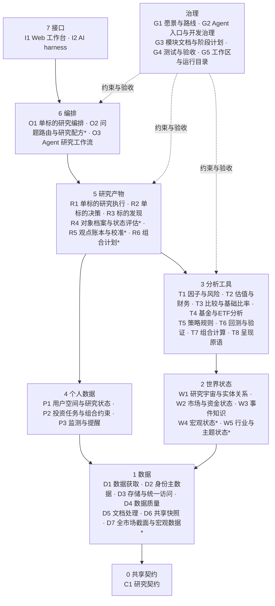
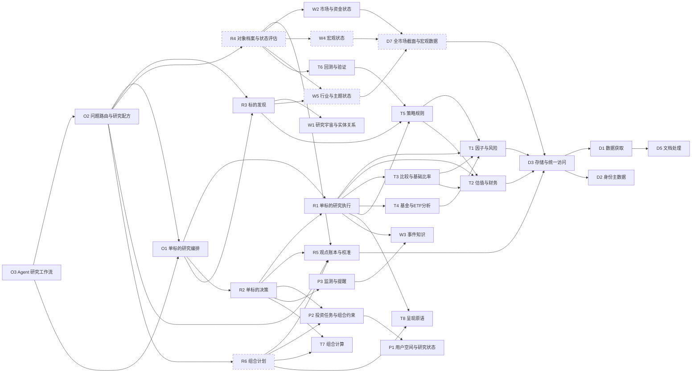

# Wealth Farm 系统模块总图

## 文档定位

本文是自顶向下的第二层：把 `docs/long_term/长期愿景.md` 的组织模型和 `docs/long_term/发展路线图.md` 的阶段，拆解为全局系统模块，并定义每个模块的功能、文件组织、依赖、支撑、关联和组织形式。

- 本文是“系统模块 ↔ 代码目录、模块文档和 Agent 指引”映射的唯一所有者。
- 分层规则、依赖方向和新能力放置规则见 `.agent/docs/develop/architecture.md`。
- 单个代码模块的细节见 `docs/modules/` 下的模块文档。
- 后续阶段计划必须声明涉及哪些系统模块；新增、拆分或合并系统模块时先修改本文。

## 一、术语

### 1. 组织形式

| 形式 | 含义 | 执行者 |
| --- | --- | --- |
| 代码执行 | 确定性 Python 代码，通过服务、CLI 或测试运行，结果可复算 | 程序 |
| 文档描述 | 需求、约束和设计；不被执行，作为开发和研究的依据 | 开发者与 Agent 阅读 |
| Agent 工作流 | 驱动 Agent 在对话中按步骤调用公共入口、推演和与用户交互的指引 | Agent |

一个系统模块可以同时具备多种形式，此时标明主次。

### 2. 关系

- **基础**：本模块依赖的系统模块。
- **支撑**：依赖本模块的系统模块。
- **关联**：不构成代码依赖，但共享数据、规则或在规划上衔接的模块。

现有模块的“基础”和“支撑”按 2026-10-25 的代码导入关系统计（不含测试）；规划模块按设计填写。所有模块都可以依赖 C1，表中不再重复列出。

### 3. 状态

- **已有**：有正式代码和测试。
- **部分**：有代码，但能力不完整，或未接入正式入口。
- **规划**：尚无代码，在路线图中有对应阶段。

## 二、总体拓扑

### 1. 分层总览

带 `*` 的模块为规划或仅部分存在。箭头表示“依赖”。

### 2. 关键模块依赖

虚线框为规划模块。图中只画主干依赖；完整关系见第四节。

## 三、模块索引

| 编号 | 系统模块 | 层 | 组织形式 | 状态 | 路线图阶段 |
| --- | --- | --- | --- | --- | --- |
| C1 | 研究契约 | 0 | 代码 | 部分 | 4 |
| D1 | 数据获取 | 1 | 代码 | 已有 | 5（新数据源） |
| D2 | 身份主数据 | 1 | 代码 | 已有 | 维护 |
| D3 | 存储与统一访问 | 1 | 代码 | 已有 | 维护 |
| D4 | 数据质量 | 1 | 代码 | 已有 | 维护 |
| D5 | 文档处理 | 1 | 代码 | 已有 | 维护 |
| D6 | 共享快照 | 1 | 代码 | 已有，暂停扩展 | 10 |
| D7 | 全市场截面与宏观数据 | 1 | 代码 | 部分 | 5 |
| W1 | 研究宇宙与实体关系 | 2 | 代码 | 已有 | 5、6 |
| W2 | 市场与资金状态 | 2 | 代码 | 部分 | 5 |
| W3 | 事件知识 | 2 | 代码 | 已有 | 10（新闻） |
| W4 | 宏观状态 | 2 | 代码 | 部分 | 5 |
| W5 | 行业与主题状态 | 2 | 代码 | 规划 | 6 |
| T1 | 因子与风险 | 3 | 代码（主）+ 文档 | 已有 | 持续 |
| T2 | 估值与财务 | 3 | 代码 | 已有 | 7 |
| T3 | 比较与基础比率 | 3 | 代码 | 部分 | 5、6 |
| T4 | 基金与ETF分析 | 3 | 代码 | 已有 | 7 |
| T5 | 策略规则 | 3 | 代码（主）+ 文档 | 已有 | 9 |
| T6 | 回测与验证 | 3 | 代码 | 部分 | 9 |
| T7 | 组合计算 | 3 | 代码 | 部分 | 8 |
| T8 | 呈现原语 | 3 | 代码 | 部分 | 8（HTML） |
| P1 | 用户空间与研究状态 | 4 | 代码 | 已有 | 8（偏好） |
| P2 | 投资任务与组合约束 | 4 | 代码 | 已有 | 8 |
| P3 | 监测与提醒 | 4 | 代码 | 已有 | 10（通知） |
| R1 | 单标的研究执行 | 5 | 代码 | 已有 | 7 |
| R2 | 单标的决策 | 5 | 代码 | 已有 | 7 |
| R3 | 标的发现 | 5 | 代码 | 部分 | 6 |
| R4 | 对象档案与状态评估 | 5 | 代码 | 部分 | 5、6、9 |
| R5 | 观点账本与校准 | 5 | 代码 | 部分 | 4 |
| R6 | 组合计划 | 5 | 代码 | 规划 | 8 |
| O1 | 单标的研究编排 | 6 | 代码 | 已有 | 维护 |
| O2 | 问题路由与研究配方 | 6 | 代码 | 已有 | 4 |
| O3 | Agent 研究工作流 | 6 | Agent 工作流 | 已有 | 4 |
| I1 | Web 工作台 | 7 | 代码 | 已有，暂停扩展 | 10 |
| I2 | AI harness | 7 | 代码 | 已有，暂停扩展 | 10 |
| G1 | 愿景与路线 | 治理 | 文档 | 已有 | — |
| G2 | Agent 入口与开发治理 | 治理 | 文档（主）+ Agent 工作流 | 已有 | — |
| G3 | 模块文档与阶段计划 | 治理 | 文档 | 已有 | — |
| G4 | 测试与验收 | 治理 | 代码 | 已有 | 4（问题验收集） |
| G5 | 工作区与运行目录 | 治理 | 文档约定 + 目录 | 已有 | — |

## 四、模块定义

### C1 研究契约

| 项 | 内容 |
| --- | --- |
| 功能 | 跨层共享的纯数据结构和枚举：研究请求、状态评估、观点、可结算动作、计划与结算规则；时间尺度、研究任务、决策简报、profile ID |
| 组织形式 | 代码 |
| 状态 | 部分：契约已定义，尚未接入账本和路由（阶段 4）；`Plan` 的完整结构规划于阶段 8 |
| 文件 | `src/research_contracts/`；`src/tests/research_contracts/`；`docs/modules/0-共享契约/研究契约模块.md` |
| 基础 | 无 |
| 支撑 | 全部层 |
| 关联 | G1 定义契约语义；R5 保存契约实例 |
| 服务问题 | 全部 |

### D1 数据获取

| 项 | 内容 |
| --- | --- |
| 功能 | 行情、财务、公告、交易所与基金披露、研报、指数成分、统计局宏观等外部数据源适配；超时与 fallback；`DataFetchService` 统一获取并落库 |
| 组织形式 | 代码 |
| 状态 | 已有 |
| 文件 | `src/data_src/`（各 Provider 子包、`models.py` 共享数据模型、`service.py`）；`src/tests/data_src/`；`docs/modules/1-数据/数据获取底层接口模块.md` |
| 基础 | D2、D3、D5 |
| 支撑 | D2、D3、D5、D6、W1、W2、W3、T4、R1、O1、I1 |
| 关联 | D4 记录跨来源对比；G5 的 `data/database/` |
| 服务问题 | 全部 |
| 已知偏离 | `models.py` 被 D2、D3、D5 当作共享类型引用，形成同层循环；引用 T4 的 ETF 净值与分红类型 |

### D2 身份主数据

| 项 | 内容 |
| --- | --- |
| 功能 | 股票、ETF、LOF、场外基金和指数的稳定 `asset_id`；多源代码映射、别名与历史名称；身份解析与歧义返回 |
| 组织形式 | 代码 |
| 状态 | 已有 |
| 文件 | `src/master_data/`；`src/tests/master_data/`；`docs/modules/1-数据/主数据与标的身份模块.md` |
| 基础 | D1 |
| 支撑 | 几乎全部模块：D1、D3、D6、W1、W3、T1–T4、T8、P1、P3、R1、R3、O1、I1、I2、G4 |
| 关联 | W5（行业与主题关系后续扩展） |
| 服务问题 | 全部 |

### D3 存储与统一访问

| 项 | 内容 |
| --- | --- |
| 功能 | SQLite 存储；按 `asset_id`、截止日、报告期和新鲜度统一访问行情、财务、公告和基金数据，并按需补取；财务报告期、TTM、单位和修订规范化 |
| 组织形式 | 代码 |
| 状态 | 已有 |
| 文件 | `src/data_store/`、`src/data_access/`、`src/financial_data/` 及对应测试；`docs/modules/1-数据/存储与统一访问模块.md`；数据库 `data/database/` |
| 基础 | D1、D2 |
| 支撑 | D4、D6、T1、T2、T3、T4、R1、R3、O1、I1；规划 D7、R5 |
| 关联 | G5 |
| 服务问题 | 全部 |

### D4 数据质量

| 项 | 内容 |
| --- | --- |
| 功能 | 任务运行记录、通用质量检查和发布判断 |
| 组织形式 | 代码 |
| 状态 | 已有 |
| 文件 | `src/data_quality/`；`src/tests/data_quality/`；`docs/modules/1-数据/数据质量与可观测性模块.md` |
| 基础 | D3 |
| 支撑 | D6、R1、O1、I1 |
| 关联 | D1 的跨来源对比 |
| 服务问题 | 全部 |

### D5 文档处理

| 项 | 内容 |
| --- | --- |
| 功能 | PDF 文本、表格、OCR 和财报字段抽取；场外基金定期报告解析 |
| 组织形式 | 代码 |
| 状态 | 已有 |
| 文件 | `src/document_processing/`；`src/tests/document_processing/`；`docs/modules/1-数据/文档处理模块.md` |
| 基础 | D1 |
| 支撑 | D1、T4 |
| 关联 | W3（全文证据，规划） |
| 服务问题 | Q3、Q8 |
| 已知偏离 | 与 D1 互相引用；引用 T4 的基金模型 |

### D6 共享快照

| 项 | 内容 |
| --- | --- |
| 功能 | 可共享、Git 友好的低频日线快照的生成与发布 |
| 组织形式 | 代码（含手动触发的 CI） |
| 状态 | 已有，暂停扩展 |
| 文件 | `src/daily_data/`（`runner.py`）；`src/tests/daily_data/`；`data/daily_data/`；`.github/workflows/update-daily-data.yml`；`docs/modules/1-数据/自动数据获取与daily_data模块.md` |
| 基础 | D1、D2、D3、D4 |
| 支撑 | 无（独立工具） |
| 关联 | P1 提供去用户化的跟踪集合；阶段 5、10 的定时运行 |
| 服务问题 | 间接支撑全部 |

### D7 全市场截面与宏观数据

| 项 | 内容 |
| --- | --- |
| 功能 | 按“日期 × 标的”组织的时点一致面板（行情、估值、财务、分类），覆盖历史指数成分和退市标的；宏观数据（增长、通胀、利率与流动性、信用、政策） |
| 组织形式 | 代码 |
| 状态 | 部分：宏观与利率序列已接入（`src/macro_data/`，阶段 5 切片二）；申万行业目录、当前成分与行业估值历史已接入（`src/sector_data/`，阶段 6 切片一）；按需截面（当前全市场、个股估值历史、报告期财务、退市、历史指数成分）已接入（`src/cross_section/`，切片二，按用户决定不做全量历史回填）；历史指数成分的 BaoStock 来源当前不可用 |
| 文件 | `src/macro_data/`（序列目录、发布日规则、多来源并发合并与存储）；`src/sector_data/`（申万行业目录、成分、同行与行业估值采样）；`src/cross_section/`（按需截面与缓存）；来源适配在 `src/data_src/macro_sources.py`、`src/data_src/chinamoney/`、`src/data_src/akshare/provider.py`、`src/data_src/tencent/provider.py`、`src/data_src/baostock/provider.py`；`docs/modules/1-数据/宏观数据模块.md`、`docs/modules/1-数据/行业分类数据模块.md`、`docs/modules/1-数据/截面数据模块.md` |
| 基础 | D1、D2、D3 |
| 支撑 | W2、W4、W5、T3、T6、R3 |
| 关联 | W1 的历史成分；G5 的存储形态（引入新依赖前需用户确认） |
| 服务问题 | Q1、Q2、Q4、Q6、Q7、Q9 |

### W1 研究宇宙与实体关系

| 项 | 内容 |
| --- | --- |
| 功能 | 版本化研究宇宙与当前指数成分、身份解析质量摘要；防止当前成分回填历史 |
| 组织形式 | 代码 |
| 状态 | 已有 |
| 文件 | `src/research_universe/`；`src/tests/research_universe/`；`docs/modules/2-世界状态/研究宇宙与指数成分模块.md` |
| 基础 | D1、D2 |
| 支撑 | R3 |
| 关联 | D7（历史成分）；W5（行业成分） |
| 服务问题 | Q6、Q9 |

### W2 市场与资金状态

| 项 | 内容 |
| --- | --- |
| 功能 | 市场宽度、涨跌停、均线宽度、成交额、指数估值序列、股权风险溢价、申万行业评估、两融、ETF 份额流、龙虎榜与大宗交易、互联互通、国家队持仓与周级代理 |
| 组织形式 | 代码 |
| 状态 | 部分：市场档案（`MarketArchiveService`）已接入容器和 CLI；其余计算服务只经 smoke 验证；没有定期快照 |
| 文件 | `src/market_analysis/`（含 `archive.py` 市场档案）、`src/state_capital_flow/`；部分因子在 `src/factor_engineering/margin.py`、`src/factor_engineering/market_event.py` 和 `src/fund_research/share_flow.py`；对应测试；`docs/modules/2-世界状态/A股市场风向标因子模块.md`、`docs/modules/2-世界状态/国家队资金周级追踪模块.md`、`docs/modules/2-世界状态/市场档案模块.md` |
| 基础 | D1（`state_capital_flow`）；D3、D7（市场档案读取指数日线与市场序列）；其余 `market_analysis` 由调用方传入数据 |
| 支撑 | R4、O2（市场简报配方） |
| 关联 | T1、T4（部分因子实现分散在这些模块）；T5 的上证多周期择时规则；R5（国家队代理方向校准是校准机制的前身） |
| 服务问题 | Q1、Q4、Q7 |

### W3 事件知识

| 项 | 内容 |
| --- | --- |
| 功能 | 公告标题规则事件、事件与标的关联和查询 |
| 组织形式 | 代码 |
| 状态 | 已有 |
| 文件 | `src/event_knowledge/`；`src/tests/event_knowledge/`；`docs/modules/2-世界状态/事件与知识抽取模块.md` |
| 基础 | D1、D2 |
| 支撑 | P3、R1、O1、I1、I2 |
| 关联 | D5（全文证据，规划）；R3（事件名称发现） |
| 服务问题 | Q1、Q3、Q8 |

### W4 宏观状态

| 项 | 内容 |
| --- | --- |
| 功能 | 增长、通胀、利率与流动性、信用、政策和外部环境的状态快照、周期位置和领先指标 |
| 组织形式 | 代码 |
| 状态 | 部分：宏观档案（增长、通胀、货币与流动性、信用、政策利率）已接入（阶段 5 切片四）；政策文本、外部环境和周期位置模型待建 |
| 文件 | `src/macro_state/`；入账与 CLI 在 `src/research_orchestration/state_archive.py`；`docs/modules/2-世界状态/宏观档案模块.md` |
| 基础 | D7、T1 |
| 支撑 | R4、O2 |
| 关联 | W2 |
| 服务问题 | Q1、Q7 |

### W5 行业与主题状态

| 项 | 内容 |
| --- | --- |
| 功能 | 行业/主题定义与成分、聚合指标、景气与产业链数据、定期快照 |
| 组织形式 | 代码 |
| 状态 | 规划（阶段 6）；已有基础：D7 的申万行业目录、成分与估值采样，W2 的申万行业评估，T3 的行业归属与默认同行 |
| 文件 | 规划在世界状态层，名称在阶段 6 计划确定 |
| 基础 | D2、D7、T1、T2 |
| 支撑 | R3、R4、T3 |
| 关联 | W1 |
| 服务问题 | Q2、Q6、Q9 |

### T1 因子与风险

| 项 | 内容 |
| --- | --- |
| 功能 | 行情因子、收益风险与风险调整指标、ETF/基金/金融机构/商品敏感度等专用指标、两融与市场事件因子；因子持久化 |
| 组织形式 | 代码（主）+ 文档（因子手册） |
| 状态 | 已有 |
| 文件 | `src/factor_engineering/`；`src/tests/factor_engineering/`；`docs/modules/3-分析工具/因子与特征工程模块.md`、`docs/modules/3-分析工具/因子与指标扩展手册.md` |
| 基础 | D2、D3 |
| 支撑 | T3、T4、T5、T6、T8、R1、R3、O1、I1、I2 |
| 关联 | W2 |
| 服务问题 | 全部 |

### T2 估值与财务

| 项 | 内容 |
| --- | --- |
| 功能 | TTM 快照、估值倍数、质量、成长、现金流和杠杆指标；金融机构指标；规划 DCF、反向 DCF 和 PB-ROE |
| 组织形式 | 代码 |
| 状态 | 已有；内在价值与隐含预期规划于阶段 7 |
| 文件 | `src/fundamental_analysis/`；`src/tests/fundamental_analysis/`；`docs/modules/3-分析工具/估值与财务分析模块.md` |
| 基础 | D2、D3 |
| 支撑 | T3、T5、T8、R1、R3、O1 |
| 关联 | W5 |
| 服务问题 | Q3、Q6、Q8、Q9 |

### T3 比较与基础比率

| 项 | 内容 |
| --- | --- |
| 功能 | 基准解析与相对表现（Beta、Alpha、跟踪误差等）；行业归属与同行集合、横向统计；同类历史分布（市场指标分位→沪深300 前瞻收益，阶段 5）；规划历史/同行估值分位（阶段 6） |
| 组织形式 | 代码 |
| 状态 | 部分 |
| 文件 | `src/benchmark_analysis/`、`src/peer_analysis/`、`src/analog_history/`（同类历史分布）及对应测试；`docs/modules/3-分析工具/比较分析模块.md` |
| 基础 | D2、D3、T1、T2、T4 |
| 支撑 | T4、R1、R3、O1、G4；规划 R5（结算基准） |
| 关联 | W5、D7 |
| 服务问题 | Q2、Q3、Q6、Q7、Q9 |
| 已知偏离 | 与 T4 互相引用 |

### T4 基金与ETF分析

| 项 | 内容 |
| --- | --- |
| 功能 | 场内 ETF 与场外基金研究数据装配、总收益、份额流、跟踪与费率指标、基准定义解析和基金摘要 |
| 组织形式 | 代码 |
| 状态 | 已有 |
| 文件 | `src/fund_research/`；`src/tests/fund_research/`；`docs/modules/3-分析工具/基金与ETF研究数据模块.md` |
| 基础 | D1、D2、D3、D5、T1、T3 |
| 支撑 | T3、R1、O1、G4（D1、D5 也引用其类型，属偏离） |
| 关联 | W2（ETF 份额流） |
| 服务问题 | Q3、Q5、Q8 |

### T5 策略规则

| 项 | 内容 |
| --- | --- |
| 功能 | 策略契约与注册表、按时间尺度的研究规则、策略证据门禁；策略来源登记 |
| 组织形式 | 代码（主）+ 文档（来源登记） |
| 状态 | 已有；策略对象化与生命周期规划于阶段 9 |
| 文件 | `src/strategy/`；`src/tests/strategy/`；`docs/evidence/strategy_sources/`；`docs/modules/3-分析工具/策略规则模块.md` |
| 基础 | T1、T2 |
| 支撑 | T6、R1、R3、O1 |
| 关联 | W2（市场择时输入） |
| 服务问题 | Q3、Q4、Q6 |
| 已知偏离 | 输入构建引用 R1 的证据包 |

### T6 回测与验证

| 项 | 内容 |
| --- | --- |
| 功能 | 日频低频回测、成本与滑点、不可成交、样本内外、事件研究与择时验证 |
| 组织形式 | 代码 |
| 状态 | 部分：单标的和小集合已有，未接入正式入口，只经 smoke 运行；多标的与组合回测规划于阶段 9 |
| 文件 | `src/backtest/`；`src/tests/backtest/`；`docs/modules/3-分析工具/低频回测模块.md` |
| 基础 | T1、T5 |
| 支撑 | 当前无生产调用方；规划支撑 R4 的策略档案 |
| 关联 | D7（截面样本） |
| 服务问题 | Q4 |
| 已知偏离 | 事件研究引用 R3 的事件名称发现 |

### T7 组合计算

| 项 | 内容 |
| --- | --- |
| 功能 | 组合估值、权重与集中度、目标波动仓位预算、单标的仓位约束计算；规划组合诊断、相关矩阵、配置与风险预算分配 |
| 组织形式 | 代码 |
| 状态 | 部分（组合级能力规划于阶段 8） |
| 文件 | `src/portfolio_risk/` 中的 `calculator.py`、`budget.py`、`position_constraints.py`；`src/tests/portfolio_risk/`；`docs/modules/4-个人数据/组合与风险管理模块.md` |
| 基础 | 无（纯计算） |
| 支撑 | P2、R2、O1；规划 R6 |
| 关联 | T6（仓位预算回测） |
| 服务问题 | Q3、Q5、Q8、Q10 |
| 已知偏离 | 与 P2 同包 |

### T8 呈现原语

| 项 | 内容 |
| --- | --- |
| 功能 | 静态图表及同源数据与元数据；报告产物落盘；规划离线 HTML 渲染 |
| 组织形式 | 代码 |
| 状态 | 部分（HTML 规划于阶段 8） |
| 文件 | `src/research_visualization/`；`src/tests/research_visualization/`；`docs/modules/3-分析工具/研究可视化模块.md`；产物 `report/`、`temp/research/` |
| 基础 | D2、T1、T2 |
| 支撑 | R1、O1；规划 R6 |
| 关联 | G5 |
| 服务问题 | 全部 |

### P1 用户空间与研究状态

| 项 | 内容 |
| --- | --- |
| 功能 | 轻量用户隔离；自选、持仓、分析报告、决策简报、探索快照与账本、去用户化跟踪集合；规划偏好、决策历史与行为记录 |
| 组织形式 | 代码 |
| 状态 | 已有 |
| 文件 | `src/user_space/`、`src/research_state/` 及对应测试；`docs/modules/4-个人数据/用户空间与研究状态模块.md` |
| 基础 | D2 |
| 支撑 | P2、P3、O1、I1、I2；规划 R6 |
| 关联 | D6（跟踪集合）；R5（用户观点入账） |
| 服务问题 | Q3、Q5、Q8、Q9、Q10 |

### P2 投资任务与组合约束

| 项 | 内容 |
| --- | --- |
| 功能 | 用户所属投资任务（mandate）、组合估值快照和约束快照的持久化与校验 |
| 组织形式 | 代码 |
| 状态 | 已有 |
| 文件 | `src/portfolio_risk/` 中的 `models.py`、`service.py`、`sqlite_repository.py`；同 T7 的测试与文档 |
| 基础 | P1、T7 |
| 支撑 | P3、R2、O1、I1；规划 R6 |
| 关联 | P1 的偏好（规划） |
| 服务问题 | Q3、Q5、Q8、Q10 |

### P3 监测与提醒

| 项 | 内容 |
| --- | --- |
| 功能 | 价格、事件、日期和组合权重规则；显式观察时评估；带研究来源链的规则；本地提醒状态 |
| 组织形式 | 代码 |
| 状态 | 已有；外部通知与定时评估规划于阶段 10 |
| 文件 | `src/alerts/`；`src/tests/alerts/`；`docs/modules/4-个人数据/提醒与触发器模块.md` |
| 基础 | D2、W3、P1、P2 |
| 支撑 | R2、O1、I1 |
| 关联 | R5（结算可复用观察记录） |
| 服务问题 | Q3、Q8、Q10 |

### R1 单标的研究执行

| 项 | 内容 |
| --- | --- |
| 功能 | 六类资产模板与研究任务；五类 profile 的正式执行服务；证据包装配；基础研究包装配、复查与渲染 |
| 组织形式 | 代码 |
| 状态 | 已有 |
| 文件 | `src/research_workflow/`、`src/research_evidence/`、`src/research_acceptance/` 中的报告装配部分及对应测试；`docs/modules/5-研究产物/单标的研究执行模块.md` |
| 基础 | D1–D4、W3、T1–T5、T8 |
| 支撑 | R2、R3、O1 |
| 关联 | G4 |
| 服务问题 | Q3、Q8、Q9 |

### R2 单标的决策

| 项 | 内容 |
| --- | --- |
| 功能 | 是否（适配）、时点、仓位三个决策对象；最终决策报告装配、复查和发布；监测交接 |
| 组织形式 | 代码 |
| 状态 | 已有；持有复核与退出计划规划于阶段 7 |
| 文件 | `src/research_orchestration/` 中的 `suitability*.py`、`entry*.py`、`position*.py`、`final_decision*.py`、`monitoring*.py`；`src/tests/research_orchestration/`；`docs/modules/6-编排/研究编排模块.md` |
| 基础 | R1、P1、P2、P3、T7 |
| 支撑 | O1；规划 R6 |
| 关联 | R5（发布的判断由 O1 投影入账）；T2 的隐含预期（规划） |
| 服务问题 | Q3、Q8 |
| 已知偏离 | 代码位于编排模块目录 |

### R3 标的发现

| 项 | 内容 |
| --- | --- |
| 功能 | 研究宇宙上的质量—估值—相对表现漏斗；事件名称注意力发现；候选、淘汰理由和任务草稿 |
| 组织形式 | 代码 |
| 状态 | 部分：质量—估值漏斗没有默认容器或 CLI 入口；事件名称发现有 CLI |
| 文件 | `src/security_discovery/`、`src/event_name_discovery/`；`src/research_orchestration/discovery.py`、`src/research_orchestration/event_name_discovery.py`；对应测试；`docs/modules/5-研究产物/标的发现模块.md`、`docs/modules/5-研究产物/事件名称注意力发现模块.md` |
| 基础 | D2、D3、W1、T1、T2、T3、T5 |
| 支撑 | O1（T6 也引用，属偏离） |
| 关联 | W5、D7（规划的多策略全市场漏斗） |
| 服务问题 | Q6、Q9 |

### R4 对象档案与状态评估

| 项 | 内容 |
| --- | --- |
| 功能 | 宏观、市场、行业/主题和策略的持续更新档案；带版本的状态评估 |
| 组织形式 | 代码 |
| 状态 | 部分：A 股市场档案与中国宏观档案已接入（阶段 5 切片三、四），系统观点可由 Agent 基于档案撰写并用 `record-view` 入账；行业阶段 6，策略阶段 9 |
| 文件 | 市场档案计算在 `src/market_analysis/archive.py`（W2），宏观档案在 `src/macro_state/`（W4），入账与 CLI 在 `src/research_orchestration/state_archive.py`；`docs/modules/2-世界状态/市场档案模块.md` |
| 基础 | W2、W4、W5、T1–T6、R5 |
| 支撑 | O2 |
| 关联 | R1（标的档案由现有单标的研究承担） |
| 服务问题 | Q1、Q2、Q4、Q7、Q9 |

### R5 观点账本与校准

| 项 | 内容 |
| --- | --- |
| 功能 | 状态评估、观点、可结算动作和计划的只追加账本；到期结算、复盘和校准摘要 |
| 组织形式 | 代码 |
| 状态 | 部分：只追加账本、最终报告发布入账与补录、Agent 改写观点入账（`record-view`）、价格类与宏观/市场指标类前向结算和复盘记录已有；行业指标结算阶段 6，校准摘要等结算样本积累后再建 |
| 文件 | `src/research_ledger/`；`src/tests/research_ledger/`；`docs/modules/5-研究产物/观点账本模块.md`；发布入账的投影位于 `src/research_orchestration/ledger_projection.py`，观点入账位于 `src/research_orchestration/view_recording.py` |
| 基础 | D2、D3、D7 |
| 支撑 | O1（发布入账、结算 CLI）；规划 R4、R6、O2、O3 |
| 关联 | P3（观察记录）；W2 |
| 服务问题 | 全部 |

### R6 组合计划

| 项 | 内容 |
| --- | --- |
| 功能 | 从组合诊断到调整方案和计划对象：定期与条件节点、目标区间、复盘节点、冲突处理；HTML 时间表 |
| 组织形式 | 代码 |
| 状态 | 规划（阶段 8） |
| 文件 | 规划在研究产物层，计划专用 HTML 模板随本模块 |
| 基础 | P1、P2、T7、T8、R2、R3、R5 |
| 支撑 | O2 |
| 关联 | P3（条件节点可转为监测规则） |
| 服务问题 | Q5、Q9、Q10 |

### O1 单标的研究编排

| 项 | 内容 |
| --- | --- |
| 功能 | 依赖装配容器；代码到任务的规划；profile 分发与基础流水线；workflow 与 handoff；探索会话持久化与查询路由；能力注册表；发现编排；CLI |
| 组织形式 | 代码 |
| 状态 | 已有 |
| 文件 | `src/research_orchestration/` 中的 `container.py`、`cli.py`、`request_planner.py`、`dispatcher.py`、`pipeline.py`、`workflow.py`、`exploration*.py`、`query_*.py`、`capabilities.py`、`discovery.py`、`event_name_discovery.py`、`ledger_projection.py`、`review.py`、`renderer.py`、`sqlite_repository.py`；`src/tests/research_orchestration/`；`docs/modules/6-编排/研究编排模块.md` |
| 基础 | D1–D4、W3、T1–T5、T7、T8、P1–P3、R1–R3、R5 |
| 支撑 | O3；规划 O2 |
| 关联 | G4（新对话验收） |
| 服务问题 | Q3、Q6、Q8 |

### O2 问题路由与研究配方

| 项 | 内容 |
| --- | --- |
| 功能 | 把结构化研究请求（对象、意图、个人上下文、深度）路由到研究配方；返回步骤状态、元素覆盖、正式缺口和用户问题；执行当前可执行的步骤 |
| 组织形式 | 代码 |
| 状态 | 已有；十个代表性问题均有配方，配方中的规划步骤随后续阶段变为可执行 |
| 文件 | `src/research_routing/`；`src/research_orchestration/routing_adapters.py`；`src/tests/research_routing/`；`docs/modules/6-编排/问题路由模块.md` |
| 基础 | C1、R5；经适配器使用 O1、R3；配方步骤引用的其余模块见 `src/research_routing/recipes.py` |
| 支撑 | O1（`route`、`run-recipe` CLI）、O3；规划 I1 |
| 关联 | G4（代表性问题验收场景） |
| 服务问题 | 全部 |

### O3 Agent 研究工作流

| 项 | 内容 |
| --- | --- |
| 功能 | 驱动 Agent 的研究指引：构造研究请求并按路由结果行动、单标的主线、冷启动、决策模型、任务策略、探索、最终报告契约、发现交接、事件名称专项和新对话验收；以及结构化证据待建时带来源的官方资料正反核查 |
| 组织形式 | Agent 工作流 |
| 状态 | 已有 |
| 文件 | `.agent/docs/research/` |
| 基础 | O2（`route`、`run-recipe`）、O1、R2、R3 的公共入口；G1 |
| 支撑 | 用户对话 |
| 关联 | G4（指引静态测试和新对话验收） |
| 服务问题 | 全部 |

### I1 Web 工作台

| 项 | 内容 |
| --- | --- |
| 功能 | 本地 FastAPI 与原生页面：用户、自选、持仓、报告、标的、因子、事件、组合估值、提醒和数据质量 |
| 组织形式 | 代码 |
| 状态 | 已有，暂停扩展 |
| 文件 | `src/web_api/`、`src/web_ui/`；`src/tests/web_api/`；`docs/modules/7-接口/网络服务与用户界面模块.md` |
| 基础 | D1–D4、W3、T1、P1–P3、I2 |
| 支撑 | 用户 |
| 关联 | O2（规划为接口入口） |
| 服务问题 | 间接 |
| 已知偏离 | 直接调用数据层、世界状态层、分析工具层和个人数据层，未经编排层 |

### I2 AI harness

| 项 | 内容 |
| --- | --- |
| 功能 | 模型无关任务、上下文与证据装配、Adapter 协议和结果持久化 |
| 组织形式 | 代码 |
| 状态 | 已有，暂停扩展 |
| 文件 | `src/ai_harness/`；`src/tests/ai_harness/`；`docs/modules/7-接口/AI API与harness模块.md` |
| 基础 | D2、W3、T1、P1 |
| 支撑 | I1 |
| 关联 | O3（IDE 中的研究由 Agent 完成，不经本模块） |
| 服务问题 | 间接 |
| 已知偏离 | 直接调用 D2、W3、T1、P1，未经编排层 |

### G1 愿景与路线

| 项 | 内容 |
| --- | --- |
| 功能 | 项目定位、代表性问题验收集、组织模型、研究纪律、阶段顺序、能力需求和系统模块拆解 |
| 组织形式 | 文档 |
| 状态 | 已有 |
| 文件 | `docs/long_term/长期愿景.md`、`docs/long_term/发展路线图.md`、`docs/long_term/系统模块总图.md` |
| 基础 | 无 |
| 支撑 | 全部模块的方向与验收基准 |
| 关联 | G2、G3 |

### G2 Agent 入口与开发治理

| 项 | 内容 |
| --- | --- |
| 功能 | Agent 每轮必读与场景路由；通用协作原则；开发规则、分层与依赖规则、计划与汇报规则 |
| 组织形式 | 文档（主）+ Agent 工作流（开发流程） |
| 状态 | 已有 |
| 文件 | `.agent/AGENT_README.md`、`.agent/SKILL.md`、`.agent/docs/README.md`、`.agent/docs/common/`、`.agent/docs/develop/`；平台入口 `AGENTS.md`、`.claude/CLAUDE.md`、`.github/copilot-instructions.md` |
| 基础 | G1 |
| 支撑 | 全部开发活动；O3 |
| 关联 | G3、G4、G5 |

### G3 模块文档与阶段计划

| 项 | 内容 |
| --- | --- |
| 功能 | 代码模块的职责、边界、输入输出和依赖；阶段计划、切片和 tracking |
| 组织形式 | 文档 |
| 状态 | 已有 |
| 文件 | `docs/modules/`；`docs/当前阶段-*.md` |
| 基础 | G1、G2 |
| 支撑 | 开发与 Agent 查阅 |
| 关联 | 各系统模块（见第四节的文件行） |

### G4 测试与验收

| 项 | 内容 |
| --- | --- |
| 功能 | 按模块的单元测试与按需 smoke；跨模块测试入口；CI；研究验收与新对话结构验收；代表性问题验收场景 `vision_q_v1` 与能力覆盖矩阵 |
| 组织形式 | 代码 |
| 状态 | 已有；独立新对话人工复核待完成 |
| 文件 | `src/tests/`（`<module>/unit_tests/`、`<module>/smoke_tests/`、`integration/`、`architecture/`、`run_all_unit_tests.py`）；`.github/workflows/unit-tests.yml`；`src/research_acceptance/` 中的验收部分；`src/research_orchestration/conversation_acceptance.py`；`src/research_routing/acceptance.py`；`docs/modules/治理/代表性研究验收模块.md` |
| 基础 | 被测模块 |
| 支撑 | 全部代码模块的质量门禁 |
| 关联 | G1（验收集）；O3（指引静态测试） |

### G5 工作区与运行目录

| 项 | 内容 |
| --- | --- |
| 功能 | 运行数据、报告、临时产物、日志、外部参考和依赖清单的目录约定 |
| 组织形式 | 文档约定 + 目录 |
| 状态 | 已有 |
| 文件 | `data/database/`（共享数据与个人数据的 SQLite）、`data/daily_data/`、`report/`、`temp/`、`logs/`、`references/`、`dependencies/requirement.txt`；规则见 `.agent/docs/develop/development_rule.md` |
| 基础 | G2 |
| 支撑 | 全部模块 |
| 关联 | D3、D6、T8 |

## 五、代表性问题与系统模块

“当前缺口模块”是 `vision_q_v1` 场景路由后非可执行元素所属的模块，由 `src/tests/research_routing/` 的测试保证与配方一致。

| 问题 | 主路径 | 当前缺口模块 |
| --- | --- | --- |
| Q1 整体市场 | O3 → O2 → R4（市场与宏观档案）→ W2、W4 → D7；可选叠加 P1、P2 | W4、T3、R4 |
| Q2 细分领域 | O3 → O2 → R4（行业档案）→ W5 → D7；T3 | W2、W5、T3、R4 |
| Q3 这个标的 | O3 → O2 → O1 → R1、R2 → T1–T5、P1–P3；R5 入账与结算 | T2 |
| Q4 策略好坏 | O3 → O2 → R4（策略档案）→ T5、T6 → D7 | T6、R4 |
| Q5 持仓更激进 | O3 → O2 → R6 → T7、P1、P2；候选来自 R3 | T7、P2、R6 |
| Q6 领域内找标的 | O3 → O2 → R3 → W1、W5、D7、T5；入选候选转 O1 | W1、R3 |
| Q7 经济危机观点 | O3 → O2 → R5（观点入账）→ W4、T3（同类历史分布）、R4 | W4、T3、T7、R4、O3 |
| Q8 持仓亏损 | O3 → O2 → O1 → R2（持有复核与退出）→ T2（隐含预期）、P1、P2 | P1、R2 |
| Q9 行业观点与推荐 | O3 → O2 → R5、R4（行业）、R3、R1/R2、R6 | R3、R4、R6、O3 |
| Q10 HTML 时间表 | O3 → O2 → R6 → T8（HTML）、R5、P1–P3 | T8、R6 |

## 六、组织形式分布

| 组织形式 | 模块 |
| --- | --- |
| 代码执行 | C1、D1–D7、W1–W5、T1–T8、P1–P3、R1–R6、O1、O2、I1、I2、G4 |
| 文档描述 | G1、G3、G5；T1 的因子手册、T5 的策略来源登记为辅 |
| Agent 工作流 | O3；G2 的开发流程为辅 |

## 七、维护规则

1. 新增代码模块时，在第四节登记所属系统模块，在 `src/tests/architecture/unit_tests/test_layer_dependencies.py` 登记所属层，并在 `docs/modules/` 建立模块文档。
2. 新增、拆分或合并系统模块时，先修改本文，再修改阶段计划和代码。
3. 阶段计划必须列出涉及的系统模块，以及是否消除第四节记录的已知偏离。
4. 每个阶段完成后，更新第三节的状态；配方步骤状态变化时，同步更新 `vision_q_v1` 场景期望和第五节的缺口模块。
