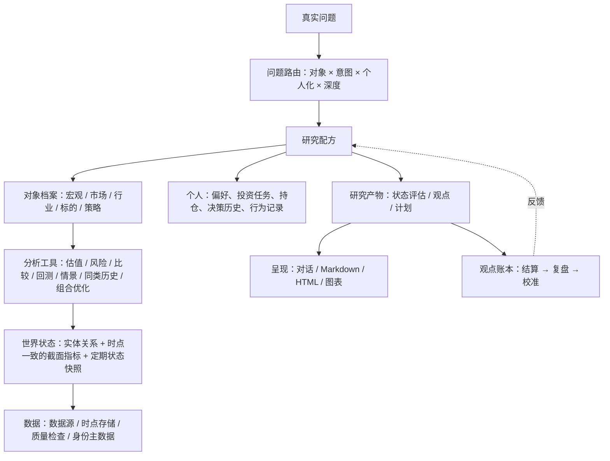

# Wealth Farm 长期愿景

## 文档定位

本文定义 Wealth Farm 要成为什么、回答哪些问题、如何组织研究，以及必须遵守的研究纪律。它是项目方向的唯一所有者文档。

- 能力建设顺序、各层能力需求和长期 tracking 见 `docs/long_term/发展路线图.md`。
- 全局系统模块拆解和关联拓扑见 `docs/long_term/系统模块总图.md`。
- 代码分层、模块归属和依赖方向见 `.agent/docs/develop/architecture.md`。
- 开发中的任何取舍都应回到本文第三节的代表性问题验收集，检查改动是否让某个问题回答得更好。

## 一、定位

Wealth Farm 是个人投资者的投研智囊系统。

它像一家小型买方投研机构：

1. 持续维护对宏观、市场、行业、标的和策略的认识。
2. 回答用户提出的各类投资问题，从了解现状、评价好坏、寻找机会，到决定动作和制定计划。
3. 检验用户自己的观点，而不是顺从它。
4. 结合用户的偏好、持仓和约束，给出可验证、可执行、可复盘的分析与规划。
5. 用事后结果持续校准自己的判断。

Wealth Farm 不是：

1. 自动交易系统：不下单、不对接券商，行动由用户执行。
2. 无条件荐股工具：推荐是基于用户约束的研究结论，必须附证据、最强反方和失效条件。
3. 数据终端：数据只为判断服务。
4. 一次性报告生成器：所有判断都进入账本，接受事后检验。

## 二、使用方式

| 维度 | 设定 |
| --- | --- |
| 主要入口 | IDE 中的对话式 Agent。Agent 理解问题、安排研究、推演和反证，并通过项目公共入口调用确定性能力 |
| 主要消费者 | Agent。入口、输出和指引首先服务 Agent 开展工作；用户通过 Agent 提问并消费报告，通常不直接运行项目。报告样式、HTML 等用户交互在核心能力建成后单独成模块 |
| 产物 | 对话回答、Markdown 报告、可离线打开的 HTML 页面（行动时间表、看板等）和静态图表，均写入工作区 |
| 用户 | 个人投资者及家庭成员；用户隔离只用于数据归属，不是安全多租户 |
| 市场范围 | A 股股票、场内 ETF 和场外基金；债券、黄金、商品和海外资产先用境内上市 ETF 或基金代理；港股、美股为远期选项 |
| 执行边界 | 只输出可验证的行动条件、计划和日历；监测规则、定时运行和外部通知都需要用户确认后启用 |

## 三、代表性问题验收集

### 1. 问题的结构

用户问题由三个维度组合而成：

1. **研究对象**：宏观、市场、行业/主题、标的、策略、组合。
2. **意图**：了解现状、评价好坏、寻找机会、检验观点、决定动作、制定计划、复盘。
3. **个人化程度**：与用户无关、可选结合用户、必须结合用户。

系统不为每个问题新建流水线，而是用研究配方组合已有能力。新问题出现时，先判断它落在哪个对象、意图和个人化组合上。

### 2. 冻结的代表性问题

下列问题是项目的需求基准。每个阶段验收都要回到这里检查：合格回答是否达成，必须避免的情况是否出现。暂时做不到的部分必须以正式缺口回答，不能用自由发挥掩盖。

#### Q1：整体市场行情怎么样？

对象与意图：市场、宏观；了解现状；可选结合用户。

必须包含：

1. 估值、趋势、宽度、资金、情绪、波动和宏观环境的当前状态，以及相对历史的位置。
2. 近期变化及其主要来源。
3. 对不同资产类别和时间尺度的含义。
4. 当前判断的把握度，以及哪些信号出现会改变判断。
5. 用户提供持仓时，对其组合的影响。

必须避免：只罗列数据；把短期波动解释为长期结论；不说明数据截止日。

#### Q2：某个细分领域现状如何？

对象与意图：行业/主题；了解现状；与用户无关。

必须包含：

1. 领域的范围和成分定义。
2. 景气与供需、竞争格局和利润分布。
3. 估值相对自身历史和市场的位置。
4. 资金、政策和所处周期位置。
5. 代表性标的及其差异。

必须避免：用行业指数涨跌代替基本面；领域定义含糊。

#### Q3：这个标的怎么样？

对象与意图：标的；评价并决定动作；可选结合用户。

必须包含：

1. 是否值得买入或继续持有、何时行动、买多少；不能回答的轨道给出正式原因。
2. 乐观、基准和悲观三情景。
3. 当前价格隐含的预期。
4. 最强反方、失效条件和复查节点。

必须避免：两面话不给结论；缺少用户约束时给伪精确仓位；把基础数据包当作结论。

#### Q4：这个策略好不好？

对象与意图：策略；评价好坏；与用户无关。

必须包含：

1. 机制和公开来源。
2. 样本内外表现，以及不同市场状态下的表现。
3. 成本、容量和可执行性。
4. 按尝试次数折扣后的显著性。
5. 与简单基准的比较。
6. 适用条件、失效条件和前向跟踪记录。

必须避免：只给回测曲线；用单段样本宣称有效；隐瞒参数尝试次数。

#### Q5：我想把现有持仓变得更激进一些，如何调整？

对象与意图：组合；改造并制定计划；必须结合用户。

必须包含：

1. 先确认“激进”的具体含义：更高权益比例、更集中、更高波动或更长期限。
2. 当前组合诊断：暴露、重叠、相关性和风险来源。
3. 调整后的风险预算。
4. 调整方案：换入换出和比例区间。
5. 分步迁移路径和时点条件。
6. 调整后的压力情景损失。

必须避免：不确认含义就加仓高波动标的；忽略已有持仓的重叠暴露。

#### Q6：帮我找一些这个领域值得投资的标的。

对象与意图：行业 → 标的；寻找机会；可选结合用户。

必须包含：

1. 研究范围。
2. 筛选规则及其依据。
3. 候选名单、入选理由、主要淘汰理由和数据缺口。
4. 候选优先级，以及建议进入深度研究的对象。

必须避免：只给名单；用近期涨幅排序代替研究；把候选说成买入结论。

#### Q7：我觉得快要经济危机了，你的观点是什么？证据和支撑？

对象与意图：用户观点（关于宏观）；检验观点；可选结合用户。

必须包含：

1. 把用户观点改写为可证伪命题：什么程度、什么时间窗口。
2. 领先指标、历史类比和同类历史的发生比例。
3. 支持和反对的证据。
4. 系统自己的概率区间和时间窗口。
5. 命题成立与不成立时对用户组合的影响，以及可选应对。
6. 会改变判断的信号。

必须避免：顺着用户观点找证据；给出精确时点；只讲叙事不给证据。

#### Q8：我买的 A 已经亏了不少，接下来怎么办？

对象与意图：持仓；决定动作；必须结合用户。

必须包含：

1. 原买入理由是否仍然成立。
2. 以“今天手持现金是否会买”重新评估。
3. 机会成本和同风险替代。
4. 该持仓在组合中的风险占比。
5. 沉没成本、处置效应等行为偏差提示。
6. 持有、加仓、减仓、退出或换仓的建议及触发条件。

必须避免：以成本价为锚；安慰式回答；为摊低成本而加仓。

#### Q9：我觉得快消行业不错，请分析一下并推荐。

对象与意图：用户观点（关于行业）→ 标的 → 组合；检验、发现并适配；必须结合用户。

必须包含：

1. 对用户观点的正反检验。
2. 行业现状分析。
3. 行业内候选及理由。
4. 与用户组合的适配和仓位区间。

必须避免：只找支持证据；推荐与用户约束冲突的标的。

#### Q10：根据我提供的信息，用 HTML 拉一份时间表。

对象与意图：计划；制定计划；必须结合用户。

时间表应描述各标的未来在什么时间节点、或触发什么条件时买卖多少，预期什么时间达到什么目标，以及合适的复盘节点和改进方法。

必须包含：

1. 每个标的的定期节点和条件节点。
2. 每个节点的动作和数量规则。
3. 目标用区间和概率表达，并注明依据。
4. 复盘节点和改进方法。
5. 组合层冲突的处理，例如现金不足和动作优先级。
6. 可离线打开的 HTML 文件，内容与结构化计划同源。

必须避免：承诺精确日期和点位；与用户约束冲突的动作；HTML 与分析结论不一致。

### 3. 其他应支持的问题

1. 这两个标的哪个更好？
2. 某个事件对我的持仓有什么影响？
3. 我的组合风险主要在哪里？
4. 上次的判断对了吗？
5. 现在股债应该怎么配？

真实使用中出现新的问题类型时，补入本节；具有代表性的，升级为冻结问题。

## 四、组织模型

### 1. 研究对象与对象档案

每个研究对象都有一份持续更新、带版本的档案。回答问题时更新档案，而不是每次从零生成报告。

| 对象 | 档案核心内容 |
| --- | --- |
| 宏观 | 增长、通胀、利率与流动性、信用、政策和外部环境；周期位置与领先指标 |
| 市场 | 估值、趋势、宽度、资金、情绪、波动和风格；市场状态 |
| 行业/主题 | 定义与成分、景气与供需、竞争格局、利润分布、估值、资金、政策和产业链 |
| 标的 | 身份、基本面、估值、风险、同行、事件、内在价值与隐含预期、相关观点 |
| 策略 | 机制、来源、适用范围、回测、稳健性、尝试次数、前向表现和生命周期状态 |
| 组合 | 持仓、权重、暴露、风险、投资任务、计划、绩效与归因 |

前五类是客观对象，可在用户之间共享；组合属于用户个人。

### 2. 研究意图与默认产物

| 意图 | 默认产物 |
| --- | --- |
| 了解现状 | 状态评估 |
| 评价好坏 | 观点 |
| 寻找机会 | 候选清单，每个候选附观点 |
| 检验观点 | 观点（含正反证据和概率） |
| 决定动作 | 观点和可结算动作 |
| 制定计划 | 计划 |
| 复盘 | 结算与复盘记录 |

### 3. 三类研究产物

**状态评估**：对象在某个截止日的状态描述和分类，例如“市场处于高估值、弱宽度状态”。必须注明数据截止和把握度；隐含的判断按观点入账。

**观点**：一个可证伪的判断，统一包含：

1. 命题、对象和时间期限。
2. 支持证据和反对证据。
3. 同类历史的发生比例（基础比率）。
4. 把握度；能量化时用概率区间。
5. 证伪条件和需要观察的信号。
6. 对用户组合或行动的含义。
7. 结算规则：到期时用什么数据、对照什么基准判定。

用户说“我觉得……”时，系统新建一个待检验的观点，而不是把它当作结论前提。观点可被新证据修订，修订以追加版本保存。

**计划**：作用于组合的一组动作规则，包含：

1. 定期节点（如财报季复查、季度再平衡）和条件节点（价格、估值、事件或风险触发）。
2. 每个动作的数量规则及其约束来源。
3. 以区间和概率表达的目标及其依据。
4. 复盘节点和改进方法。
5. 跨标的冲突的处理规则。
6. 版本和实际执行偏离。

**可结算动作**是单标的决策、标的发现和组合计划的共同接口。每个动作必须具备：触发条件、可观察键、有效窗口、动作、数量规则、失效条件和结算方式。

### 4. 两种时间模式与三档深度

1. **持续维护**：宏观、市场和行业状态按固定节奏刷新并保存快照。回答现状类问题时读取最新快照，保证快速、前后一致，并留下历史判断供校准。
2. **按需研究**：标的、策略、组合和观点检验在提问时执行。

每个问题按深度分三档：

1. 快速：读取已有快照和档案，秒级回答。
2. 标准：运行确定性配方，生成基础研究包。
3. 深度：Agent 多轮探索、反证和用户交互后形成最终结论。

用户可以要求升档；把握度不足时，系统主动建议升档。

### 5. 先客观、后个人

研究分两步：先形成对象层的客观判断，再叠加用户的偏好、持仓、约束和行为记录，生成个人化的动作和计划。客观判断不得因用户偏好改写；个人化内容不得写回共享档案。

### 6. 观点账本与五类闭环

所有状态评估、观点、动作和计划都进入账本。发布后不得修改，只能追加结算和复盘。

| 闭环 | 回答的问题 | 节奏 |
| --- | --- | --- |
| 数据质量 | 数据对不对 | 每次获取 |
| 策略验证 | 规则在历史和前向样本中是否有效 | 研发时与持续跟踪 |
| 判断结算 | 系统和用户的判断事后是否正确 | 观点到期 |
| 组合归因 | 收益来自配置、选择、择时还是运气 | 月、季 |
| 偏好校准 | 用户声明的风险承受力与真实行为是否一致 | 回撤后与定期 |

Agent 回答新问题时可以读取同类判断的历史准确率，作为把握度的参考，但不得据此直接改写结论。

### 7. 对照投研机构的分工

项目借用投研机构的分工确定对象、产物和节奏，而不是做角色扮演。

| 机构角色 | 产出 | 节奏 | 项目中对应 |
| --- | --- | --- | --- |
| 宏观策略 | 宏观观点、市场展望 | 周、月 | 宏观与市场档案 |
| 行业研究 | 行业报告、行业内排序 | 月、季 | 行业档案与行业内发现 |
| 个股研究 | 首次覆盖、跟踪更新 | 事件驱动 | 标的档案与单标的决策 |
| 量化研究 | 策略评估 | 研发时 | 策略档案与生命周期 |
| 组合经理 | 组合构建、调仓 | 周、月 | 组合诊断、配置与计划 |
| 风控 | 风险报告、限额 | 日、周 | 组合风险与约束 |
| 交易 | 执行计划 | 按计划 | 计划与行动日历 |
| 绩效复盘 | 归因、复盘 | 月、季 | 观点账本、结算与校准 |
| 投委会 | 正反方辩论后拍板 | 重大决策 | 观点检验与最强反方门禁 |

## 五、能力分层

| 层 | 职责 |
| --- | --- |
| 数据 | 数据源、时点一致存储、全市场截面、质量检查和身份主数据 |
| 世界状态 | 市场、行业、指数、标的和管理人的实体关系；时点一致的截面指标；定期状态快照 |
| 分析工具 | 估值、风险、比较、回测、情景、同类历史分布和组合优化等可复用计算 |
| 个人 | 偏好、投资任务、持仓、决策历史、行为记录和监测规则 |
| 研究产物 | 对象档案、状态评估、观点、计划和观点账本 |
| 编排 | 问题路由、研究配方、Agent 探索与门禁 |
| 呈现 | 对话、Markdown、HTML 和图表；只消费结构化产物，不包含研究判断 |

Agent 与确定性代码的分工：

1. 确定性代码负责数据、计算、门禁、产物落盘、结算和呈现。
2. Agent 负责把问题转成结构化研究请求、安排探索、推演、反证、与用户交互和撰写叙事。
3. Agent 不得用提示词伪造确定性结果；能力缺失时报告正式缺口。

## 六、研究纪律

### 1. 时间尺度

1. **短期（不超过 1 个月）**：负责择时，使用价格、成交、波动、事件、流动性、相对强弱和市场风险状态；只能回答“现在是否适合行动”。
2. **中短期（1 至 6 个月）**：负责投机性机会，使用催化剂、业绩预期差、估值修复、行业景气和中期趋势；必须声明兑现窗口、失败条件和损失边界。
3. **中长期（6 个月至 3 年）**：负责投资，使用盈利、现金流、ROIC、竞争格局、管理层执行、合理估值和安全边际。
4. **长期（超过 3 年）**：负责穿越周期，使用商业模式、护城河、资本配置、治理、结构趋势、机会成本和永久性资本损失。

每个指标、策略和观点必须声明时间尺度。长期价值、短期时点和组合仓位分别形成结论，再解释冲突，不求平均。

### 2. 纪律条目

1. **时点一致**：所有事实不得晚于数据截止日；财务数据在发布日期后才可使用；历史研究使用当时的指数成分并保留退市标的。
2. **证据可追溯**：关键数据优先使用官方来源，并用独立来源或独立算法核验；结论区分事实、推断、假设和未知。
3. **精确计算**：市值、估值、币种、单位和股本使用精确十进制并独立复核；语言模型不负责关键金融算术。
4. **反证先于结论**：每个观点必须有最强反方和证伪条件；资料多不等于确定性高，资料少也不等于标的差。
5. **外部视角**：重要预测先看同类历史的发生比例，再看个案差异。
6. **不制造精度**：概率、目标价、目标时点和仓位只在输入和方法足够时给出，并用区间表达。
7. **用户观点是假设**：正反两面检验，不顺从。
8. **资产类型差异**：普通公司、金融机构、周期资源、高成长未盈利公司、ETF 和场外基金使用不同模板，不套用同一指标。
9. **回测纪律**：处理未来数据、复权、停牌、成本、滑点、成分变化、样本外、过拟合和幸存者偏差，并登记尝试次数。
10. **前向校准**：判断进入账本并按期结算；语言模型的知识可能覆盖历史回放期，Agent 判断只用真实前向样本校准。

## 七、边界

1. 不下单，不对接券商。
2. 监测规则、定时运行和外部通知都需要用户确认后启用。
3. 推荐是基于用户约束的研究结论，不是无条件的买入建议。
4. 预测类内容只在方法和输入足够时给出，并以区间和条件表达。
5. 用户隔离只用于数据归属，不是安全多租户。
6. 外部参考项目只吸收思想，不作为运行依赖。

## 八、成功标准

1. 代表性问题验收集中每个问题都有合格回答，或有明确的正式缺口和补齐计划。
2. 观点账本积累真实前向判断并按期结算，各类判断的准确度对用户可见。
3. 同一问题在同一数据截止日的回答一致、可复算。
4. 新问题类型能通过组合已有配方和能力支持，而不是新建流水线。
5. 系统支持的真实决策数量及其事后质量持续可衡量。
