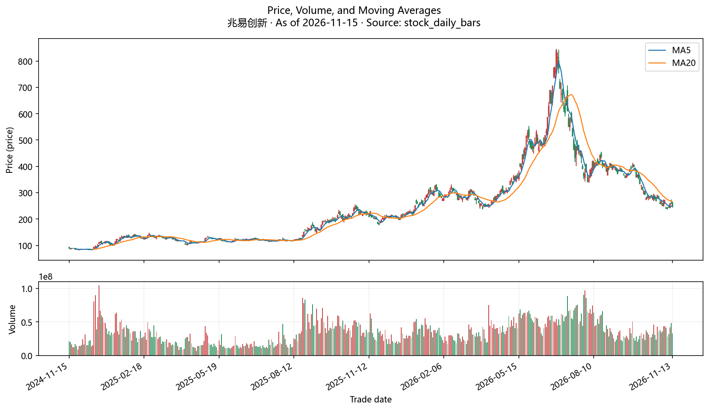
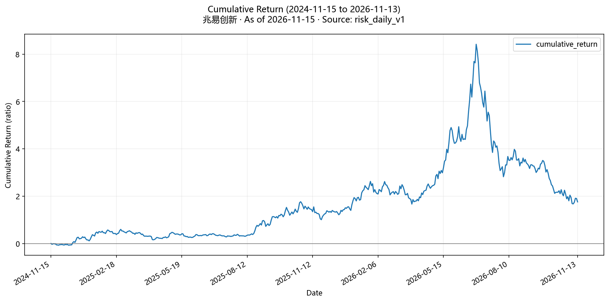
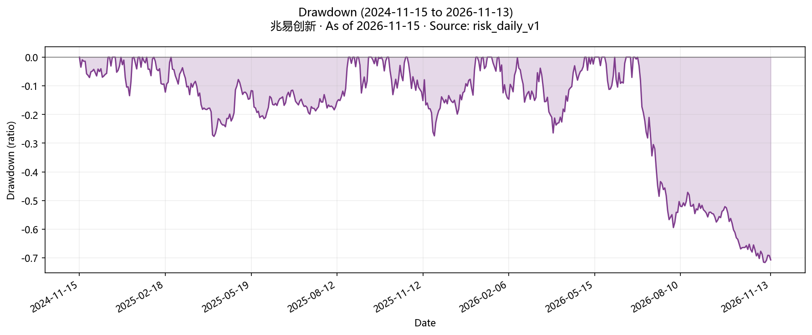
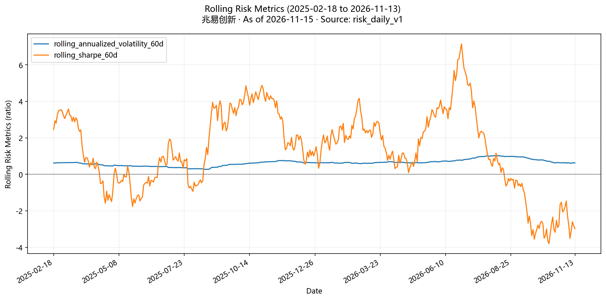

# 兆易创新 基础研究包

- 截止日：2026-11-15

## 自动收集后的初步判断
- 自动收集已完成：行情、数据质量检查、因子与风险指标、基本面指标、相对基准、公告与研报证据、静态图表、研究规则。
- 中长期质量与估值规则结论为“通过”；这是研究规则结果，不是投资指令。

## 行情与覆盖
- 最新收盘价：246.02元（来源记录，截至2026-11-13）
  - 限制：未复权价格。
- 行情覆盖：484个交易日，2024-11-15至2026-11-13（来源记录，截至2026-11-13）

## 收益与风险指标
- 本节口径：按执行窗口内的复权总回报计算（交易所前收盘价链接，含分红再投资，已消除送转、拆分和份额折算的影响）。
- 区间年化收益率：69.77%（派生指标，截至2026-11-13）
- 区间年化波动率：66.38%（派生指标，截至2026-11-13）
- 区间最大回撤：-71.62%（派生指标，截至2026-11-13）
- 区间夏普比率：1.127（派生指标，截至2026-11-13）
- 区间索提诺比率：1.784（派生指标，截至2026-11-13）
- 区间卡玛比率：0.974（派生指标，截至2026-11-13）
- 最长回撤持续时间：137天（派生指标，截至2026-11-13）

## 相对基准表现
- 本节口径：标的按复权总回报计算，基准为价格指数、不含分红，超额收益偏高约一个区间股息率；实际区间为2024-11-15至2026-11-13。
- 比较基准：沪深300指数（来源记录，截至2026-11-13）
- 区间累计收益率（标的）：175.78%（派生指标，截至2026-11-13）
- 区间累计收益率（基准）：1.2%（派生指标，截至2026-11-13）
- 相对基准超额收益：174.59%（派生指标，截至2026-11-13）
- 年化主动风险（跟踪误差）：58.09%（派生指标，截至2026-11-13）
- 信息比率：1.253（派生指标，截至2026-11-13）
- Beta：2.333（派生指标，截至2026-11-13）
- 与基准相关系数：0.59（派生指标，截至2026-11-13）
- 共同交易日数：483个（派生指标，截至2026-11-13）

## 相对行业表现
- 本节口径：申万行业指数为价格指数，不含分红；实际区间为2024-11-15至2026-11-13。行业按申万当前成分归属。
- 行业基准：申万电子（来源记录，截至2026-11-13）
- 区间累计收益率（行业指数）：49.65%（派生指标，截至2026-11-13）
- 相对行业超额收益：136.6%（派生指标，截至2026-11-13）
- 与行业指数相关系数：0.754（派生指标，截至2026-11-13）

## 估值
- 本节口径：基于2026-09-30报告期财报与截至2026-11-13的最新收盘价，流量项为滚动十二个月（TTM）口径。
- 本节口径：历史与同行分位见“估值位置”一节。
- 总市值：1,731.91亿元（派生指标，截至2026-11-15）
- 企业价值：1,543.83亿元（派生指标，截至2026-11-15）
- 市盈率（TTM）：14.89倍（派生指标，截至2026-11-15）
- 扣非市盈率（TTM）：17.56倍（派生指标，截至2026-11-15）
- 市净率：2.25倍（派生指标，截至2026-11-15）
- 市销率（TTM）：7.64倍（派生指标，截至2026-11-15）
- 市现率（TTM）：16.56倍（派生指标，截至2026-11-15）
- 盈利收益率：6.72%（派生指标，截至2026-11-15）
- 自由现金流收益率：5.03%（派生指标，截至2026-11-15）
- 股息率：0.3%（派生指标，截至2026-11-15）

## 盈利能力
- 本节口径：基于2026-09-30报告期财报，流量项为滚动十二个月（TTM）口径。
- 本节口径：仅当前一期，未形成多期趋势。
- ROE：24.48%（派生指标，截至2026-11-15）
- 扣非 ROE：20.76%（派生指标，截至2026-11-15）
- 非经常性损益占归母净利润：15.21%（派生指标，截至2026-11-15）
- ROA：21.46%（派生指标，截至2026-11-15）
- ROIC：35.15%（派生指标，截至2026-11-15）
- 毛利率：63.99%（派生指标，截至2026-11-15）
- 营业利润率：57.6%（派生指标，截至2026-11-15）
- 净利率：51.31%（派生指标，截至2026-11-15）

## 成长
- 营业收入同比增速：165.51%（派生指标，截至2026-11-15）
  - 限制：2026-09-30报告期相对上年同期计算，流量项为滚动十二个月（TTM）口径。
- 净利润同比增速：759.19%（派生指标，截至2026-11-15）
  - 限制：2026-09-30报告期相对上年同期计算，流量项为滚动十二个月（TTM）口径。
- 扣非净利润同比增速：661.39%（派生指标，截至2026-11-15）
  - 限制：2026-09-30报告期相对上年同期计算，流量项为滚动十二个月（TTM）口径。
- 经营现金流同比增速：430.53%（派生指标，截至2026-11-15）
  - 限制：2026-09-30报告期相对上年同期计算，流量项为滚动十二个月（TTM）口径。
- 自由现金流同比增速：693.4%（派生指标，截至2026-11-15）
  - 限制：2026-09-30报告期相对上年同期计算，流量项为滚动十二个月（TTM）口径。
- 年初至2026-09-30累计同比（不滚动）：营业收入 +197.11%；归母净利润 +921.55%；扣非归母净利润 +805.26%（派生指标，截至2026-11-15）
  - 限制：TTM 增速反映过去四个季度，拐点会滞后；两者方向不同时，本行更接近最新趋势。

## 资产负债
- 本节口径：基于2026-09-30报告期末资产负债表。
- 资产负债率：12.02%（派生指标，截至2026-11-15）
- 净负债：-188.08亿元（派生指标，截至2026-11-15）

## 研发投入
- 研发费用率：6.45%（派生指标，截至2026-11-15）
  - 限制：基于2026-09-30报告期，流量项为滚动十二个月（TTM）口径。
  - 限制：研发费用率 = 费用化研发支出 ÷ 营业收入，不含资本化部分。

## 分红
- 近 12 个月分红：近 12 个月每股现金分红 0.750 元（除息日 2026-05-26 每股 0.750 元），按现价 246.02 元股息率 0.30%（派生指标，截至2026-11-15）
  - 限制：新浪财经分红记录（已实施方案，派息按除息日归属）
  - 限制：只算已实施的现金分红（含税），已公告未除息的方案不计入；未按送转股调整。
- 按除息年度的每股分红：2021 年 0.560 元；2022 年 1.060 元；2023 年 0.620 元；2025 年 0.340 元；2026 年 0.750 元（派生指标，截至2026-11-15）
  - 限制：按除息日所在年度归属，不等于按会计年度的分配方案。

## 估值位置
- 本节口径：自身历史为月末样本加最新一天（东方财富，2018 年起）；同行为申万当前成分，取截止日或之前最近一天的估值；PE 只在盈利样本中排位。
- 市盈率(TTM)自身历史分位：1%（当前14.89倍；2018-11-30至2026-11-13 共97个样本，中位数97.65倍）（派生指标，截至2026-11-13）
- 市盈率(TTM)同行分位：10%（申万数字芯片设计 42家有效样本，同行中位数45.90倍）（派生指标，截至2026-11-15）
- 市净率自身历史分位：1%（当前2.25倍；2018-11-30至2026-11-13 共97个样本，中位数7.34倍）（派生指标，截至2026-11-13）
- 市净率同行分位：2%（申万数字芯片设计 55家有效样本，同行中位数5.49倍）（派生指标，截至2026-11-15）
- 市销率自身历史分位：7%（当前7.64倍；2018-11-30至2026-11-13 共97个样本，中位数12.34倍）（派生指标，截至2026-11-13）
- 市销率同行分位：45%（申万数字芯片设计 55家有效样本，同行中位数9.08倍）（派生指标，截至2026-11-15）

## 隐含预期与内在价值
- 本节口径：情景区间与敏感性只说明假设变化时价值的范围，不是目标价；反向 DCF 说明价格隐含的预期，不说明市场错了
- 隐含增速：自由现金流（TTM，经营现金流 − 购建长期资产）：企业价值 1544 亿元隐含未来 10 年年增 -0.7%，之后永续 2%（派生指标，截至2026-11-15）
- 隐含增速：扣非归母净利润（TTM）：市值 1732 亿元隐含未来 10 年年增 -0.8%，之后永续 2%（派生指标，截至2026-11-15）
- 情景区间：悲观（年增 -10.0%）每股 118.88 元，较现价 -52%；基准（年增 -5.0%）每股 176.20 元，较现价 -28%；乐观（年增 0.0%）每股 263.47 元，较现价 +7%。基准增速取近 3 年扣非利润复合增速（不可算时依次用归母、营收），限制在 -5%–20%，悲观与乐观各 ±5%；情景以扣非归母净利润（TTM）为基数（派生指标，截至2026-11-15）
- 隐含回报：若基准增速 -5.0% 兑现，按现价买入的年化回报约 5.2%（对照折现率 6.61%、10 年国债 1.61%）（派生指标，截至2026-11-15）
- 敏感性：折现率 5.61%–7.61%、永续增长 1%–3% 下，基准情景每股 136.69–273.45 元（派生指标，截至2026-11-15）
- 历史增速：2022–2025 年报 3 年复合增速：扣非 -8.4%、归母 -7.1%、营收 4.2%；2015–2025 营收复合增速 22.7%（派生指标，截至2026-11-15）
- 假设：折现率 6.61% = 10 年国债 1.61%（2026-11-13） + 股权风险溢价 5%；永续增长 2%；显式期 10 年（派生指标，截至2026-11-15）

## 研究规则检查
- 规则结论：通过（中长期质量与估值规则；得分1，通过线0.65）（派生指标，截至2026-11-15）
  - 限制：阈值是初始研究假设
  - 限制：未经回测，也未按同行标准化
  - 限制：置信度只反映必需输入是否齐全，不代表结论正确的概率
  - 限制：规则结果有效期至2027-02-13。
- 硬性门槛：ROIC ≥ 10%（当前35.15%，满足）；自由现金流收益率 > 0%（当前5.03%，满足）（派生指标，截至2026-11-15）
  - 限制：阈值为研究假设，未经回测或同行标准化。
- 否决条件：资产负债率 > 70%（当前12.02%，未触发）（派生指标，截至2026-11-15）
  - 限制：阈值为研究假设，未经回测或同行标准化。
- 评分条件：ROE ≥ 15%（当前24.48%，满足，权重25%）；ROIC ≥ 15%（当前35.15%，满足，权重25%）；营业收入同比增速 > 0%（当前165.51%，满足，权重20%）；市盈率（TTM） ≤ 30倍（当前14.89倍，满足，权重30%）（派生指标，截至2026-11-15）
  - 限制：阈值为研究假设，未经回测或同行标准化。

## 公告与研报
- 证据覆盖：官方公告30条，第三方研报38条，结构化事件6个（2025-05-16至2026-11-15）（来源记录，截至2026-11-15）
- 公告：H股公告-翌日披露报表（官方披露，截至2026-11-04）
- 公告：兆易创新关于以集中竞价交易方式回购A股股份的进展公告（官方披露，截至2026-11-03）
- 公告：兆易创新关于召开2026年第三季度业绩说明会的公告（官方披露，截至2026-10-30）
- 公告：兆易创新2026年第三季度报告（官方披露，截至2026-10-30）
- 公告：H股公告-翌日披露报表（官方披露，截至2026-10-30）
- 研报：公司简评报告：利基DRAM产能或增长，产品不断迭代增强长期竞争力（东海证券，买入）（来源记录，截至2026-09-10）
  - 限制：第三方观点，不代表官方披露。
- 研报：利基存储景气度持续，2Q26扣非归母净利润环比增长146%（国信证券，增持）（来源记录，截至2026-08-25）
  - 限制：第三方观点，不代表官方披露。
- 研报：存储产品量价齐升，MCU价格开启温和上行（交银国际证券，买入）（来源记录，截至2026-08-20）
  - 限制：第三方观点，不代表官方披露。

## 静态图表

## 初始三情景

### 乐观情景
- 已满足的条件（自由现金流收益率 > 0%；营业收入同比增速 > 0%；市盈率（TTM） ≤ 30倍等）在下次刷新后继续成立。

### 基准情景
- 当前中长期质量与估值规则结论：通过。

### 悲观情景
- 已满足的条件在刷新后失效，或规则本身的限制变得重要。

## 最强反方
- 规则本身的主要限制：阈值是初始研究假设

## 失效条件
- 刷新数据后，硬性门槛或否决条件的判定发生变化（核心前提失效）

## 缺口
- 暂无执行缺口；能力边界见各节口径与限制。
