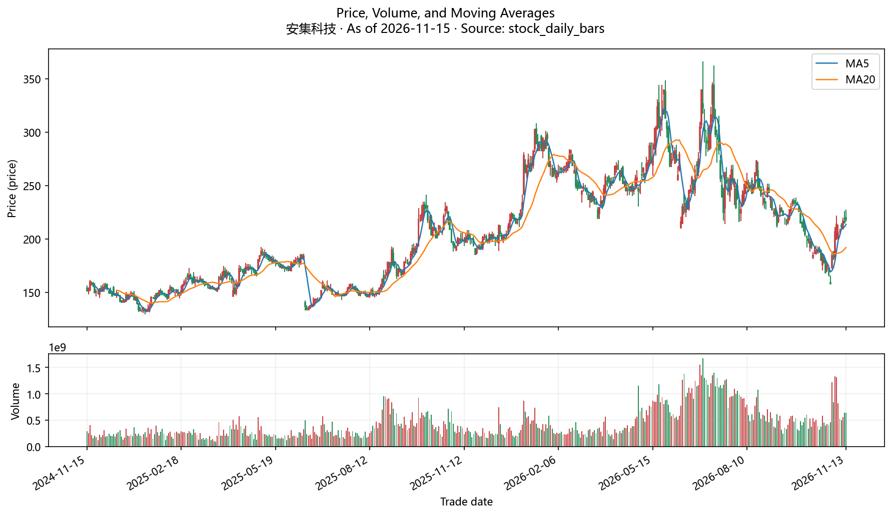
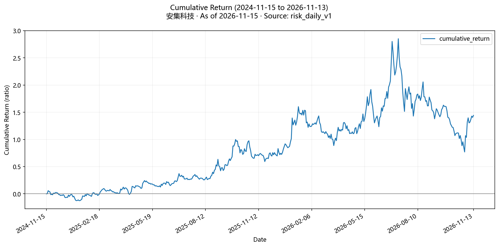
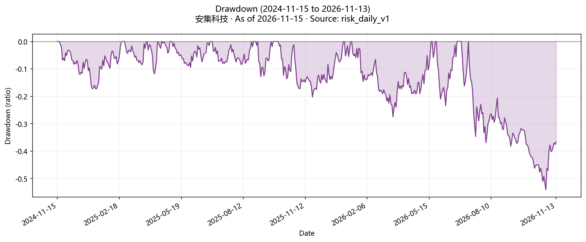
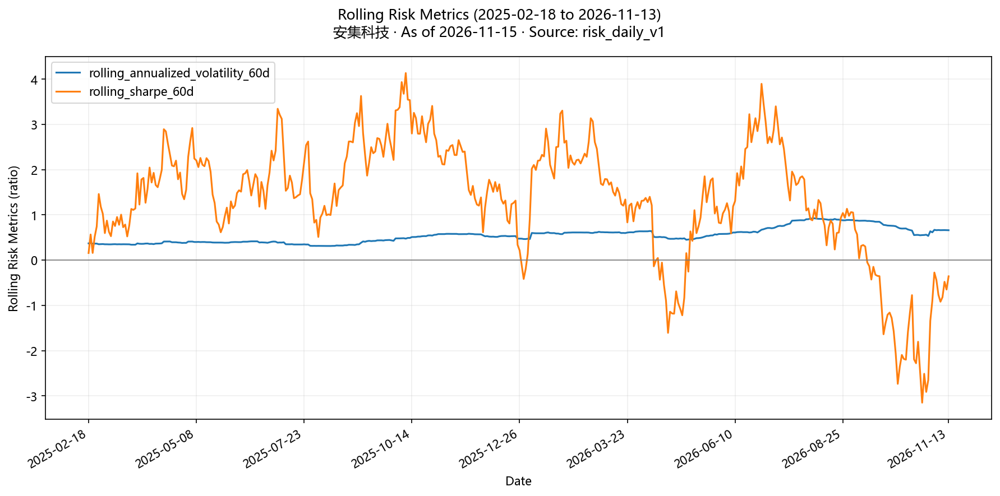

# 安集科技 基础研究包

- 截止日：2026-11-15

## 自动收集后的初步判断
- 自动收集已完成：行情、数据质量检查、因子与风险指标、基本面指标、相对基准、公告与研报证据、静态图表、研究规则。
- 中长期质量与估值规则结论为“通过”；这是研究规则结果，不是投资指令。

## 行情与覆盖
- 最新收盘价：218元（来源记录，截至2026-11-13）
  - 限制：未复权价格。
- 行情覆盖：484个交易日，2024-11-15至2026-11-13（来源记录，截至2026-11-13）

## 收益与风险指标
- 本节口径：按执行窗口内的复权总回报计算（交易所前收盘价链接，含分红再投资，已消除送转、拆分和份额折算的影响）。
- 区间年化收益率：59.32%（派生指标，截至2026-11-13）
- 区间年化波动率：57.08%（派生指标，截至2026-11-13）
- 区间最大回撤：-54.06%（派生指标，截至2026-11-13）
- 区间夏普比率：1.097（派生指标，截至2026-11-13）
- 区间索提诺比率：1.79（派生指标，截至2026-11-13）
- 区间卡玛比率：1.097（派生指标，截至2026-11-13）
- 最长回撤持续时间：127天（派生指标，截至2026-11-13）

## 相对基准表现
- 本节口径：标的按复权总回报计算，基准为价格指数、不含分红，超额收益偏高约一个区间股息率；实际区间为2024-11-15至2026-11-13。
- 比较基准：沪深300指数（来源记录，截至2026-11-13）
- 区间累计收益率（标的）：144.18%（派生指标，截至2026-11-13）
- 区间累计收益率（基准）：1.2%（派生指标，截至2026-11-13）
- 相对基准超额收益：142.98%（派生指标，截至2026-11-13）
- 年化主动风险（跟踪误差）：50.35%（派生指标，截至2026-11-13）
- 信息比率：1.203（派生指标，截至2026-11-13）
- Beta：1.785（派生指标，截至2026-11-13）
- 与基准相关系数：0.524（派生指标，截至2026-11-13）
- 共同交易日数：483个（派生指标，截至2026-11-13）

## 相对行业表现
- 本节口径：申万行业指数为价格指数，不含分红；实际区间为2024-11-15至2026-11-13。行业按申万当前成分归属。
- 行业基准：申万电子（来源记录，截至2026-11-13）
- 区间累计收益率（行业指数）：49.65%（派生指标，截至2026-11-13）
- 相对行业超额收益：100.15%（派生指标，截至2026-11-13）
- 与行业指数相关系数：0.72（派生指标，截至2026-11-13）

## 估值
- 本节口径：基于2026-09-30报告期财报与截至2026-11-13的最新收盘价，流量项为滚动十二个月（TTM）口径。
- 本节口径：历史与同行分位见“估值位置”一节。
- 总市值：497.82亿元（派生指标，截至2026-11-15）
- 企业价值：486.58亿元（派生指标，截至2026-11-15）
- 市盈率（TTM）：32.14倍（派生指标，截至2026-11-15）
- 扣非市盈率（TTM）：56.16倍（派生指标，截至2026-11-15）
- 市净率：8.63倍（派生指标，截至2026-11-15）
- 市销率（TTM）：15.82倍（派生指标，截至2026-11-15）
- 市现率（TTM）：63.77倍（派生指标，截至2026-11-15）
- 盈利收益率：3.11%（派生指标，截至2026-11-15）
- 自由现金流收益率：0.43%（派生指标，截至2026-11-15）
- 股息率：0.23%（派生指标，截至2026-11-15）

## 盈利能力
- 本节口径：基于2026-09-30报告期财报，流量项为滚动十二个月（TTM）口径。
- 本节口径：仅当前一期，未形成多期趋势。
- ROE：34.02%（派生指标，截至2026-11-15）
- 扣非 ROE：19.47%（派生指标，截至2026-11-15）
- 非经常性损益占归母净利润：42.78%（派生指标，截至2026-11-15）
- ROA：26.36%（派生指标，截至2026-11-15）
- ROIC：41.17%（派生指标，截至2026-11-15）
- 毛利率：56.27%（派生指标，截至2026-11-15）
- 营业利润率：55.55%（派生指标，截至2026-11-15）
- 净利率：49.23%（派生指标，截至2026-11-15）

## 成长
- 营业收入同比增速：34.76%（派生指标，截至2026-11-15）
  - 限制：2026-09-30报告期相对上年同期计算，流量项为滚动十二个月（TTM）口径。
- 净利润同比增速：106.72%（派生指标，截至2026-11-15）
  - 限制：2026-09-30报告期相对上年同期计算，流量项为滚动十二个月（TTM）口径。
- 扣非净利润同比增速：30.3%（派生指标，截至2026-11-15）
  - 限制：2026-09-30报告期相对上年同期计算，流量项为滚动十二个月（TTM）口径。
- 经营现金流同比增速：77.29%（派生指标，截至2026-11-15）
  - 限制：2026-09-30报告期相对上年同期计算，流量项为滚动十二个月（TTM）口径。
- 自由现金流同比增速：31.11%（派生指标，截至2026-11-15）
  - 限制：2026-09-30报告期相对上年同期计算，流量项为滚动十二个月（TTM）口径。
- 年初至2026-09-30累计同比（不滚动）：营业收入 +35.45%；归母净利润 +125.83%；扣非归母净利润 +35.32%（派生指标，截至2026-11-15）
  - 限制：TTM 增速反映过去四个季度，拐点会滞后；两者方向不同时，本行更接近最新趋势。

## 资产负债
- 本节口径：基于2026-09-30报告期末资产负债表。
- 资产负债率：17.01%（派生指标，截至2026-11-15）
- 净负债：-11.24亿元（派生指标，截至2026-11-15）

## 研发投入
- 研发费用率：16.2%（派生指标，截至2026-11-15）
  - 限制：基于2026-09-30报告期，流量项为滚动十二个月（TTM）口径。
  - 限制：研发费用率 = 费用化研发支出 ÷ 营业收入，不含资本化部分。

## 分红
- 近 12 个月分红：近 12 个月每股现金分红 0.500 元（除息日 2026-06-10 每股 0.500 元），按现价 218.00 元股息率 0.23%（派生指标，截至2026-11-15）
  - 限制：新浪财经分红记录（已实施方案，派息按除息日归属）
  - 限制：只算已实施的现金分红（含税），已公告未除息的方案不计入；未按送转股调整。
- 按除息年度的每股分红：2022 年 0.319 元；2023 年 0.420 元；2024 年 0.350 元；2025 年 0.450 元；2026 年 0.500 元（派生指标，截至2026-11-15）
  - 限制：按除息日所在年度归属，不等于按会计年度的分配方案。

## 估值位置
- 本节口径：自身历史为月末样本加最新一天（东方财富，2018 年起）；同行为申万当前成分，取截止日或之前最近一天的估值；PE 只在盈利样本中排位。
- 市盈率(TTM)自身历史分位：2%（当前32.14倍；2019-07-31至2026-11-13 共89个样本，中位数60.62倍）（派生指标，截至2026-11-13）
- 市盈率(TTM)同行分位：10%（申万电子化学品Ⅲ 30家有效样本，同行中位数62.26倍）（派生指标，截至2026-11-15）
- 市净率自身历史分位：37%（当前8.63倍；2019-07-31至2026-11-13 共89个样本，中位数9.83倍）（派生指标，截至2026-11-13）
- 市净率同行分位：89%（申万电子化学品Ⅲ 35家有效样本，同行中位数4.47倍）（派生指标，截至2026-11-15）
- 市销率自身历史分位：40%（当前15.82倍；2019-07-31至2026-11-13 共89个样本，中位数18.41倍）（派生指标，截至2026-11-13）
- 市销率同行分位：91%（申万电子化学品Ⅲ 35家有效样本，同行中位数6.48倍）（派生指标，截至2026-11-15）

## 隐含预期与内在价值
- 本节口径：情景区间与敏感性只说明假设变化时价值的范围，不是目标价；反向 DCF 说明价格隐含的预期，不说明市场错了
- 隐含增速：自由现金流（TTM，经营现金流 − 购建长期资产）：企业价值 487 亿元隐含未来 10 年年增 32.1%，之后永续 2%（派生指标，截至2026-11-15）
- 隐含增速：扣非归母净利润（TTM）：市值 498 亿元隐含未来 10 年年增 13.6%，之后永续 2%（派生指标，截至2026-11-15）
- 隐含高增长年限：按历史增速 32.4%，需持续 4 年才能支撑当前价格（派生指标，截至2026-11-15）
- 情景区间：悲观（年增 15.0%）每股 243.34 元，较现价 +12%；基准（年增 20.0%）每股 358.95 元，较现价 +65%；乐观（年增 25.0%）每股 524.59 元，较现价 +141%。基准增速取近 3 年扣非利润复合增速（不可算时依次用归母、营收），限制在 -5%–20%，悲观与乐观各 ±5%；情景以扣非归母净利润（TTM）为基数（派生指标，截至2026-11-15）
- 隐含回报：若基准增速 20.0% 兑现，按现价买入的年化回报约 9.0%（对照折现率 6.61%、10 年国债 1.61%）（派生指标，截至2026-11-15）
- 敏感性：折现率 5.61%–7.61%、永续增长 1%–3% 下，基准情景每股 250.46–632.64 元（派生指标，截至2026-11-15）
- 历史增速：2022–2025 年报 3 年复合增速：扣非 32.4%、归母 37.5%、营收 32.5%；2016–2025 营收复合增速 32.7%（派生指标，截至2026-11-15）
- 假设：折现率 6.61% = 10 年国债 1.61%（2026-11-13） + 股权风险溢价 5%；永续增长 2%；显式期 10 年（派生指标，截至2026-11-15）

## 研究规则检查
- 规则结论：通过（中长期质量与估值规则；得分0.7，通过线0.65）（派生指标，截至2026-11-15）
  - 限制：阈值是初始研究假设
  - 限制：未经回测，也未按同行标准化
  - 限制：置信度只反映必需输入是否齐全，不代表结论正确的概率
  - 限制：规则结果有效期至2027-02-13。
- 硬性门槛：ROIC ≥ 10%（当前41.17%，满足）；自由现金流收益率 > 0%（当前0.43%，满足）（派生指标，截至2026-11-15）
  - 限制：阈值为研究假设，未经回测或同行标准化。
- 否决条件：资产负债率 > 70%（当前17.01%，未触发）（派生指标，截至2026-11-15）
  - 限制：阈值为研究假设，未经回测或同行标准化。
- 评分条件：ROE ≥ 15%（当前34.02%，满足，权重25%）；ROIC ≥ 15%（当前41.17%，满足，权重25%）；营业收入同比增速 > 0%（当前34.76%，满足，权重20%）；市盈率（TTM） ≤ 30倍（当前32.14倍，未满足，权重30%）（派生指标，截至2026-11-15）
  - 限制：阈值为研究假设，未经回测或同行标准化。

## 公告与研报
- 证据覆盖：官方公告30条，第三方研报8条，结构化事件6个（2025-05-16至2026-11-15）（来源记录，截至2026-11-15）
- 公告：简式权益变动报告书-科创半导体ETF华夏（官方披露，截至2026-11-13）
- 公告：关于股东权益变动的提示性公告（官方披露，截至2026-11-13）
- 公告：2026年第三季度报告（官方披露，截至2026-10-31）
- 公告：申万宏源证券承销保荐有限责任公司关于安集微电子科技（上海）股份有限公司2026年半年度持续督导跟踪报告（官方披露，截至2026-09-12）
- 公告：关于向香港联合交易所有限公司递交H股发行并上市申请的公告（官方披露，截至2026-09-03）
- 研报：公司简评报告：3+1平台协同放量，扣非净利润稳步提升（东海证券，增持）（来源记录，截至2026-11-12）
  - 限制：第三方观点，不代表官方披露。
- 研报：公司产品持续放量，3Q扣非后净利润增长超6成（群益证券，增持）（来源记录，截至2026-11-02）
  - 限制：第三方观点，不代表官方披露。
- 研报：业绩稳步提升，抛光液稳健增长、功能性湿电子化学品快速放量（中银证券，买入）（来源记录，截至2026-08-31）
  - 限制：第三方观点，不代表官方披露。

## 静态图表

## 初始三情景

### 乐观情景
- 已满足的条件（自由现金流收益率 > 0%；营业收入同比增速 > 0%；ROE ≥ 15%等）在下次刷新后继续成立。

### 基准情景
- 当前中长期质量与估值规则结论：通过。

### 悲观情景
- 未满足或已触发的条件（市盈率（TTM） ≤ 30倍）继续恶化，或已满足的条件在刷新后失效。

## 最强反方
- 未满足的规则条件：市盈率（TTM） ≤ 30倍。

## 失效条件
- 刷新数据后，硬性门槛或否决条件的判定发生变化（核心前提失效）

## 缺口
- 暂无执行缺口；能力边界见各节口径与限制。
