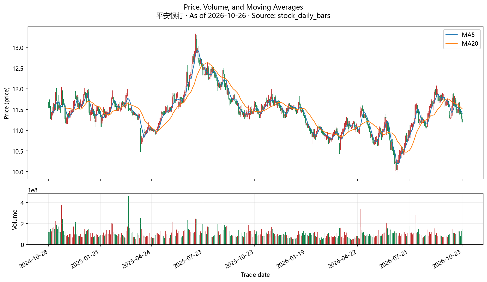
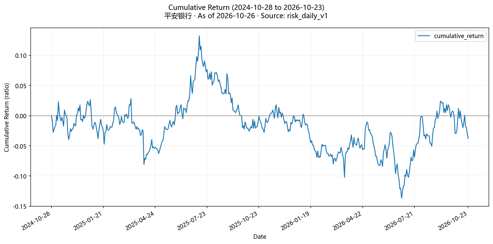
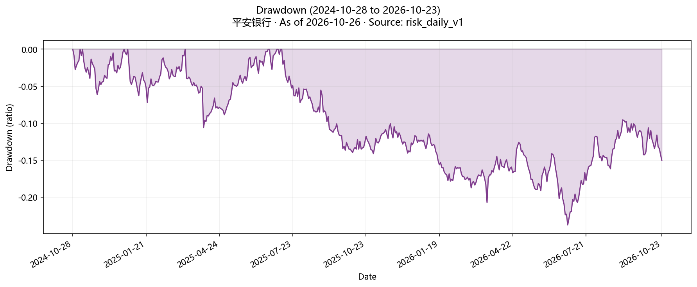
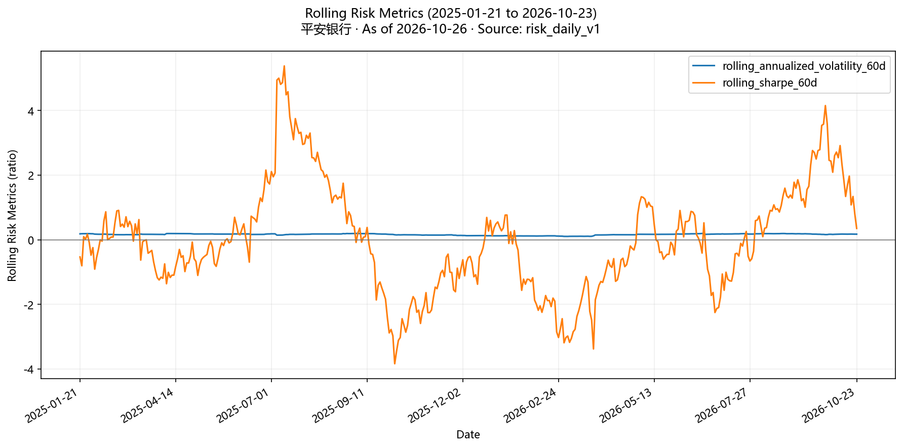

# 平安银行 完整决策报告

- 截止日：2026-10-26
- 角色：本报告是在基础研究包与多轮探索完成后形成的决策文档；仓位结果是规划边界，不是交易订单。

## 决策摘要
- **是否购买：证据不足。** 当前证据不足，无法可靠回答是否值得配置。
- **何时购买：证据不足。** 当前证据不足，无法给出可靠行动时点。
- **购买多少：暂不可用。** 是否配置结论证据不足，暂不计算仓位区间。

## 用户目标与适用边界
- 决策目标：复核持仓
- 研究期限：中长期
- 持仓状态：已经持有
- 组合角色：尚未确认。
- 用户约束：未提供。
- 用户确认的假设：用户原话说明已买入且亏损，持仓状态按已持有记录；数量、成本、买入时间未提供。
- 用户确认的假设：研究期限沿用规划默认中长期，用户未确认。
- 仍缺少的用户信息：组合角色
- 仍缺少的用户信息：当前持仓数量与成本
- 仍缺少的用户信息：投资授权与风险预算
- 仍缺少的用户信息：组合约束与估值快照

## 标的与核心论文
- 基础事实包：[查看基础研究包](平安银行-基础研究包-2026-10-26.md)
- 基础包状态：完整
- 推断：资本与拨备足以吸收当前可见的资产质量压力：核心一级资本充足率 9.61% 高于监管要求约 1.9 个百分点，拨备覆盖率约 215%，不良贷款率 1.05% 持平。（证据 1）
  - 证伪条件：后续定期报告关注类贷款占比升到 2.5% 以上
  - 证伪条件：拨备覆盖率跌破 200%
  - 证伪条件：核心一级资本充足率跌破 9%
  - 预期观察：年报关注类贷款占比不高于 2.07%，逾期 90 天以上偏离度回落

### 关键图表

## 是否值得买
- 当前答案：证据不足
- 结论边界：当前证据不足，无法可靠回答是否值得配置。
- 事实：收益来源：2026-09-30 资本充足率 13.40%、一级资本充足率 11.26%、核心一级资本充足率 9.61%（2025 年末分别为 13.77%、11.49%、9.36%），均高于监管要求（10.75%、8.75%、7.75%），核心一级资本较上年末提高 0.25 个百分点；2026 年 3 月赎回 200 亿元优先股。不良贷款率 1.05%（与 2025 年末持平，2024 年末 1.06%），拨备覆盖率 214.75%，拨贷比 2.25%。（证据 1）
  - 限制：三季报未经审计
  - 限制：未取得 2025 年年报原文，缺更长的多年序列
  - 限制：监管要求按三季报披露口径
- 事实：收益来源：2026 年 1-9 月营业收入 1,031.00 亿元（同比 +2.4%），归母净利润 391.86 亿元（同比 +2.2%），年化加权平均净资产收益率 10.77%；净息差 1.80%（2025 年全年 1.78%），存款付息率 1.35%（同比下降 35 个基点），财富管理手续费收入 46.80 亿元（同比 +17.6%），成本收入比 27.01%。归属普通股股东每股净资产 24.56 元（2025 年末 23.25 元）。（证据 1）
  - 限制：三季报未经审计
  - 限制：息差企稳主要来自负债成本下降，资产端收益率仍在下行
- 事实：收益来源：2025 年全年每 10 股派 5.96 元（中期 2.36 元 + 末期 3.60 元，末期除息日 2026-06-12）；2026 年中期每 10 股派 2.49 元（较上年中期 +5.5%），合计 48.32 亿元，除息日 2026-09-24。（证据 2、3）
  - 限制：分红由董事会和股东大会决定，未来金额不确定
  - 限制：2026 年末期分红尚未公布
- 推断：收益来源：按 2026-10-23 收盘 11.20 元：市净率约 0.46 倍；1-9 月每股收益 1.94 元年化约 2.59 元，对应市盈率约 4.3 倍；近 12 个月每股派息 0.36 + 0.249 = 0.609 元，股息率约 5.4%（税前）。若盈利与分红大体维持，持有回报主要来自约 5% 的分红加上留存带来的每股净资产增长，而不是估值修复。（证据 7、1、2、3）
  - 限制：Agent 按原文数字计算，未经项目确定性流程
  - 限制：未扣除个人股息税
  - 限制：不是收益预测，未考虑估值倍数变化
- 事实：定价隐含预期：2024-10-28 至 2026-10-23（未复权）：平安银行 -3.78%，沪深 300 +3.56%，超额 -7.34 个百分点；Beta 0.268。大盘波动不是主要驱动。（证据 7）
  - 限制：未复权、不含分红
  - 限制：沪深 300 是宽基替代，不是银行业基准
  - 限制：只覆盖过去两年
- 推断：定价隐含预期：按'合理市净率 =（可持续净资产收益率 - 增长率）/（要求回报率 - 增长率）'粗算，取要求回报率 9%~10%、长期增长率 2%~3%，0.46 倍市净率对应市场隐含的可持续净资产收益率约 5%~6%，远低于当前年化约 10.8%。即当前价格已在定价'未来信用成本明显上升或盈利能力大幅下滑'；只要净资产收益率不跌到 6% 以下，当前价格本身不要求盈利增长。（证据 7、1）
  - 限制：项目暂无反向估值等定量定价预期工具，以上为 Agent 粗算，未经项目确定性流程
  - 限制：要求回报率与增长率是假设
  - 限制：缺市净率历史分位与同行比较
- 事实：主要下行：资产质量领先指标走弱：关注类贷款占比 2.07%（2025 年末 1.75%，余额 +19.5%），可疑类余额 +30.5%；逾期 90 天以上贷款偏离度 0.83（2025 年末 0.56），逾期 60 天以上偏离度 0.98（0.67）；拨备覆盖率 214.75%（2025 年末 220.88%，2024 年末 250.71%），拨贷比 2.25%（2.33%、2.66%），逾期 90 天以上贷款拨备覆盖率 258.42%（2025 年末 397.10%）。1-9 月核销 197.02 亿元、收回不良资产 293.27 亿元。（证据 1）
  - 限制：三季报未经审计
  - 限制：领先指标上升不必然转化为不良，需后续季度验证
- 事实：主要下行：资产端仍在收缩和降价：贷款平均收益率 3.60%（同比下降 37 个基点，其中个人贷款 4.42%，下降 51 个基点）；贷款本金较上年末仅 +1.2%，其中个人贷款 -0.3%（信用卡 -0.8%、消费贷 -1.0%、经营贷 -1.5%，按揭 +3.0%）；三季度单季归母净利润 134.90 亿元，同比仅 +0.2%，单季净息差 1.79%（二季度 1.81%）。（证据 1）
  - 限制：三季报未经审计
  - 限制：单季数据波动较大
- 事实：主要下行：2024-10-28 至 2026-10-23（未复权、不含分红）：区间年化收益 -1.99%，年化波动 16.64%，最大回撤 -23.75%，最长回撤持续 470 天；价格高点约 13.3 元（2025 年 7-8 月），低点约 10.0 元（2026 年 6 月下旬），10-23 收盘 11.20 元，较高点回撤约 15%。最近 5 个交易日收盘由 11.65 元降到 11.20 元。（证据 7、8）
  - 限制：未复权、不含分红
  - 限制：高低点与当前回撤为图表读数
  - 限制：历史回撤不代表未来最大损失
- 事实：主要下行：第三方研报观点分歧：太平洋 2026-08-25《平安银行2026年中报点评：净息差企稳，财富管理带动中收增长》评级买入；国信证券 2026-08-16《2026年中报点评：资产质量改善》与 2026-04-26《2025年报及2026一季报点评：收入利润增速均回正》均为中性。（证据 4、5、6）
  - 限制：只读了标题与评级，未读正文
  - 限制：第三方观点，不是官方事实
- 推断：主要下行：反方的强形式（信用成本上升已侵蚀利润与分红）目前没有出现：1-9 月归母净利润 +2.2%，不良率持平，对公房地产贷款余额较上年末减少 217.25 亿元至 1,884.56 亿元、不良率降至 1.80%（-0.42 个百分点），2026 年中期分红提高 5.5%。（证据 1、3）
  - 限制：只有三个季度信息，领先指标的影响可能在 2027 年才体现
  - 限制：三季报未经审计
- 事实：可比替代：同区间（2024-10-29 至 2026-10-23，482 个共同交易日，未复权）：平安银行累计 -3.78%，华夏中证银行ETF 累计 +23.66%，平安银行超额 -27.44 个百分点；相对该 ETF 的 Beta 0.869、相关系数 0.784、跟踪误差 10.5%、信息比率 -1.22。同样的银行业暴露，分散持有的银行指数过去两年明显更好。（证据 9）
  - 限制：未复权、不含分红
  - 限制：Agent 另用数据接口比对了另外 3 只银行 ETF（515290、512730、159887），同期涨幅 +21%~+22%，结论一致；该比对未入账
  - 限制：华宝中证银行ETF（512800）因 2025-07 份额折算导致未复权价格跳变，比较结果失真，未采用
  - 限制：项目缺同行业分类，未与其他银行个股比较
  - 限制：历史区间结果不能外推
- 推断：机会成本：含分红粗算：区间内已知除息 0.236 + 0.36 + 0.249 = 0.845 元，约为起点价 11.64 元的 7.3%，平安银行含息回报约 +3.5% 以上（未计 2024 年度末期分红），仍明显落后银行 ETF 的未复权 +23.66%。继续持有平安银行而不是银行指数，等于在银行业暴露之外额外押注平安银行自身（零售信贷修复）；这部分个股风险过去两年没有得到补偿。（证据 9、2、3）
  - 限制：Agent 粗算，未经项目确定性流程
  - 限制：ETF 收益分配未核实
  - 限制：2024 年度末期分红金额未读原文
  - 限制：历史区间结果不能外推
- 不可用原因：缺少用户确认的组合角色。
- 限制：缺少同行行业归属，未做同行比较。

## 何时行动
- 当前答案：证据不足
- 结论边界：当前证据不足，无法给出可靠行动时点。
- 推断：当前状态（中性）：按 10-23 收盘 11.20 元，市净率约 0.46 倍、股息率约 5.4%：绝对水平低，但缺历史分位与同行对比，银行股低市净率较普遍，不能单凭估值判断处于有利位置；估值状态记为中性。（证据 7、1、2、3）
  - 限制：缺市净率历史分位与同行对比
  - 限制：股息率为 Agent 计算，税前
- 推断：当前状态（中性）：价格从 6 月下旬约 10.0 元低点反弹到 9 月约 11.9 元后回落，10-23 收盘 11.20 元；5 日、20 日均线均向下，价格位于 20 日均线（约 11.5 元）下方。短期趋势偏弱，中期区间震荡；趋势状态记为中性。（证据 8、7）
  - 限制：均线与高低点为图表读数
  - 限制：未复权、不含分红
  - 限制：价格趋势对中长期回报解释力有限
- 推断：当前状态（中性）：相对沪深 300 的 Beta 约 0.27，相对银行 ETF 的 Beta 约 0.87、相关系数约 0.78：价格主要随银行板块和自身基本面波动，大盘系统性风险不是主要驱动；市场风险状态记为中性。（证据 7、9）
  - 限制：基于过去两年数据
  - 限制：未评估当前整体市场估值与流动性
- 推断：进入条件（观察中）：加仓只在同时满足以下条件时考虑：用户确认组合角色与单标的上限且当前仓位低于上限；关注类贷款占比回落到 2% 以下；核心一级资本充足率保持在 9.5% 以上。不以摊低成本为加仓理由。目前关注类占比 2.07%，条件未满足，处于观察。（证据 1、11）
  - 限制：阈值是研究假设，未经回测
  - 限制：关注类占比要到年报才能再次观察
- 推断：等待条件（已满足）：三季报后首个交易周内，不因短期价格反应加仓，也不因亏损情绪一次性清仓；该条件当前成立。持有者需要先确认这笔仓位的角色、占比和资金期限，再决定是否调整。（证据 10、1、11）
  - 限制：等待一周可能错过价格变化
  - 限制：若用户有确定的近期资金需求，应优先满足资金需求而不是等待
- 推断：分批规则（观察中）：若用户决定减仓或把部分仓位换成银行指数 ETF，分 2~3 批在不同交易日执行，避免在单日情绪波动中一次完成；本研究不给出每批数量，数量取决于用户的持仓与约束。（证据 8、9）
  - 限制：分批规则是研究建议，未经回测
  - 限制：用户持仓数量未知
- 推断：回避条件（未满足）：下一份定期报告若出现任一情况，则不加仓并优先考虑降低仓位：关注类贷款占比升到 2.5% 以上、拨备覆盖率跌破 200%、核心一级资本充足率跌破 9%。按三季报数据（2.07%、214.75%、9.61%）目前均未触发。（证据 1）
  - 限制：阈值是研究假设，未经回测
  - 限制：三季报未经审计
- 推断：催化窗口（观察中）：三季报于 2026-10-24（周六）披露，10-26～10-30 是市场首次交易消化三季报的一周；下一份定期报告是 2026 年年报（法定最晚 2027-04-30 披露），在此之前没有新的定期财务数据。（证据 10、1）
  - 限制：年报具体披露日期未从交易所预约披露表核实
  - 限制：事件库可能存在同步延迟
- 推断：执行约束（已满足）：深市主板 T+1、涨跌幅 ±10%、买入以 100 股为单位（按 11.20 元约 1,120 元一手）；日成交量多在 1 亿股上下（约 11 亿元），流动性不构成执行障碍。个人持股不满 1 年卖出时，已领取的分红需按持股期限补缴股息税（以 2025 年末期为例：1 个月以内每 10 股补 0.72 元，1 个月至 1 年补 0.36 元，超过 1 年免税）。（证据 8、7、2）
  - 限制：成交量为图表读数
  - 限制：补税标准以每次分派公告为准
  - 限制：用户买入时间未知，是否需要补税无法判断
- 事实：当前信号有效期截至2026-12-31。（证据 7、1、2、3、8、9、11、10）
- 事实：下一可交易候选时间为2026-10-26T09:30:00+08:00。（证据 8）
- 不可用原因：是否配置结论证据不足，行动时点与仓位暂不装配。
- 限制：分红政策由董事会决定，可能调整
- 限制：项目没有交易日历查询能力，按周一且非法定节假日推断
- 限制：当日盘中价格未入库，以实际行情为准

## 购买多少
- 当前答案：暂不可用
- 结论边界：是否配置结论证据不足，暂不计算仓位区间。
- 不可用原因：是否配置结论证据不足，行动时点与仓位暂不装配。
- 限制：所有已列缺口解决前不给出仓位区间。

## 三情景

### 乐观情景
- 假设：关注类贷款占比和逾期偏离度在年报中回落，拨备覆盖率稳定在 210% 以上，说明三季度的领先指标上升是暂时的
- 假设：全年归母净利润保持正增长，2026 年全年每股分红不低于 2025 年的 0.596 元
- 观察变量：年报关注类贷款占比与逾期 90 天以上偏离度
- 观察变量：年报拨备覆盖率
- 观察变量：2026 年全年归母净利润同比与全年每股分红
- 决策影响：最强反方被削弱；在你补充这笔仓位的角色和占比后，可以按持仓复核评估是否继续持有。即使如此，也不以摊低成本为理由加仓。（证据 1、2、3）
- 限制：一份年报的改善不足以确认资产质量拐点
- 限制：阈值是研究假设，未经回测

### 基准情景
- 假设：不良贷款率维持在 1.0%~1.2%，领先指标小幅波动但未触发 2.5% 关注类、200% 拨备覆盖率的阈值
- 假设：利润持平到小幅增长，分红大体维持，估值维持在约 0.4~0.5 倍市净率
- 观察变量：不良贷款率
- 观察变量：全年归母净利润同比
- 观察变量：每股分红
- 观察变量：市净率
- 决策影响：持有回报主要来自约 5% 的税前股息加每股净资产增长，而不是估值修复；但过去两年同类银行指数 ETF 明显更好，持有者应比较继续持有单一银行与换成分散的银行指数 ETF。（证据 7、1、9、2）
- 限制：回报为粗略估算，未考虑估值倍数变化与个人股息税
- 限制：未复权、不含分红

### 悲观情景
- 假设：关注类贷款占比升到 2.5% 以上或拨备覆盖率跌破 200%，信用成本上升
- 假设：全年归母净利润同比转负，或每股分红下降
- 观察变量：年报关注类贷款占比
- 观察变量：年报拨备覆盖率
- 观察变量：全年归母净利润同比
- 观察变量：2026 年末期分红方案
- 决策影响：回避条件触发：不加仓，并优先考虑分批降低仓位；以分红和净资产增长为回报来源继续持有的判断失效。（证据 1、7、3）
- 限制：过去两年最大回撤约 24% 不代表未来最大损失
- 限制：领先指标上升不必然转化为不良

## 最强反方
- 推断：资产质量压力后移：关注类与逾期偏离度上升、拨备覆盖率连续下降，未来信用成本上升将侵蚀利润与分红，使按约 11.20 元持有平安银行的回报继续落后于银行板块。（证据 1、9、7、3）
  - 证伪条件：年报显示关注类贷款占比回落到 1.9% 以下且逾期 90 天以上偏离度回到 0.7 以下
  - 预期观察：年报关注类占比继续上升、拨备覆盖率继续下降、利润同比转负

## 失效、退出与复查
- 建议最晚复查日：2026-11-02
- 待确认的机器观察候选：'以分红和净资产增长为回报来源继续持有'的判断在以下情况失效：不良贷款率升到 1.2% 以上、全年归母净利润同比转负，或每股分红较上年下降。目前不良率 1.05%、1-9 月利润 +2.2%、中期分红 +5.5%，处于观察。，最晚复查2026-12-31（证据 1、2、3）
  - 限制：阈值是研究假设，未经回测
  - 限制：分红政策由董事会决定，可能调整
  - 限制：监测适配器与启用状态需在后续由用户确认。
- 需要人工复查：后续定期报告关注类贷款占比升到 2.5% 以上，最晚复查2026-11-02（证据 1）
  - 限制：当前未绑定可机器执行的公共监测适配器。
- 需要人工复查：拨备覆盖率跌破 200%，最晚复查2026-11-02（证据 1）
  - 限制：当前未绑定可机器执行的公共监测适配器。
- 需要人工复查：核心一级资本充足率跌破 9%，最晚复查2026-11-02（证据 1）
  - 限制：当前未绑定可机器执行的公共监测适配器。
- 需要人工复查：2026 年全年归母净利润同比转负，最晚复查2026-11-02（证据 1、2、3、7、9）
  - 限制：当前未绑定可机器执行的公共监测适配器。
- 需要人工复查：每股分红较上年下降，最晚复查2026-11-02（证据 1、2、3、7、9）
  - 限制：当前未绑定可机器执行的公共监测适配器。
- 需要人工复查：归属普通股股东每股净资产较上一报告期下降，最晚复查2026-11-02（证据 1、2、3、7、9）
  - 限制：当前未绑定可机器执行的公共监测适配器。
- 需要人工复查：年报显示关注类贷款占比升到 2.5% 以上或拨备覆盖率跌破 200%，此时应考虑降低仓位而非等待，最晚复查2026-11-02（证据 10、1、11）
  - 限制：当前未绑定可机器执行的公共监测适配器。
- 需要人工复查：按用户给出的可承受组合损失与约 24% 压力跌幅计算，平安银行可承受占比低于当前实际占比，最晚复查2026-11-02
  - 限制：当前未绑定可机器执行的公共监测适配器。
- 监测边界：本计划仅为待确认建议；未经用户确认不会启用规则或通知。

## 关键证据与未知

### 关键证据
- 证据 1：[平安银行 2026 年第三季度报告（未经审计）](https://static.cninfo.com.cn/finalpage/2026-10-24/1225620609.PDF)（官方来源，巨潮资讯网（平安银行公告），2026-10-24）
- 证据 2：[平安银行 2025 年年度权益分派实施公告](https://static.cninfo.com.cn/finalpage/2026-06-05/1225352449.PDF)（官方来源，巨潮资讯网（平安银行公告），2026-06-05）
- 证据 3：[平安银行 2026 年半年度权益分派实施公告](https://static.cninfo.com.cn/finalpage/2026-09-17/1225568476.PDF)（官方来源，巨潮资讯网（平安银行公告），2026-09-17）
- 证据 4：平安银行2026年中报点评：净息差企稳，财富管理带动中收增长（太平洋证券，买入）（来源记录，东方财富研报中心（第三方券商研报转载），2026-08-25）
  - 限制：只读了标题与评级，未读正文
  - 限制：第三方观点，不是官方事实
- 证据 5：2026年中报点评：资产质量改善（国信证券，中性）（来源记录，东方财富研报中心（第三方券商研报转载），2026-08-16）
  - 限制：只读了标题与评级，未读正文
  - 限制：第三方观点，不是官方事实
- 证据 6：2025年报及2026一季报点评：收入利润增速均回正（国信证券，中性）（来源记录，东方财富研报中心（第三方券商研报转载），2026-04-26）
  - 限制：只读了标题与评级，未读正文
  - 限制：第三方观点，不是官方事实
- 证据 7：平安银行基础研究包（2026-10-26）（项目派生，本项目计算）
  - 派生方法：项目基础研究流水线：日线行情计算收益、波动与回撤；以沪深 300 为比较基准计算超额与 Beta；按 2026-09-30 报告期与 2026-10-23 收盘价计算估值与银行指标。
  - 限制：未复权、不含分红
  - 限制：沪深 300 是宽基替代，不是银行业基准
  - 限制：单期指标，无历史分位与同行比较
- 证据 8：平安银行日线行情查询（截至 2026-10-23）（项目派生，本项目计算）
  - 派生方法：项目数据访问服务读取已存储的股票日线（腾讯行情源），返回覆盖区间与最近 5 条记录。
  - 限制：未复权、不含分红
  - 限制：2026-10-26 当日无记录
- 证据 9：平安银行相对华夏中证银行ETF（515020）的基准比较（2024-10-29 至 2026-10-23）（项目派生，本项目计算）
  - 派生方法：项目基准分析服务：按 482 个共同交易日计算累计收益、超额、Beta、相关系数、跟踪误差与信息比率。
  - 限制：未复权、不含分红
  - 限制：ETF 收益分配未核实
  - 限制：历史区间结果不能外推
- 证据 10：事件：平安银行 2026 年第三季度报告披露（2026-10-24）（项目派生，本项目计算）
  - 派生方法：项目事件库从官方披露中抽取的结构化事件，用于确定定期报告披露节奏。
  - 限制：事件库可能存在同步延迟
- 证据 11：决策简报缺项：组合角色、当前持仓明细、投资任务、组合约束均未提供（用户确认，用户研究状态（本次对话））
  - 限制：用户只说明已买入且亏损，未提供数量、成本和占比

### 仍可能改变结论的未知
- 你的持仓数量、成本、占总资产比例、买入时间与当初买入理由都未提供；这笔仓位的组合角色、投资期限、可承受亏损和单只股票上限也未提供。'中长期'期限是系统默认，不是你的陈述。
- 下一份定期报告是 2026 年年报（法定最晚 2027-04-30 披露），关注类贷款和逾期偏离度能否回落要到那时才能再次检验。
- 未取得 2025 年年报原文，缺完整多年财务序列。
- 缺市净率历史分位数据，无法判断 0.46 倍市净率在平安银行自身历史中的位置。
- 收益、回撤与基准比较均未复权、不含分红；银行指数 ETF 是否有收益分配未核实。
- 持股不满 1 年卖出需补缴股息税；你的买入时间未知，无法判断是否涉及。
- 研报只读了标题与评级，未读正文。
- 当前不会自动把缺口转成查询并循环执行。
- 缺少同行行业归属，未做同行比较。
- 缺少用户确认的组合角色。
- 是否配置结论证据不足，行动时点与仓位暂不装配。
- 总体限制：报告结论仅适用于声明的截止日、用户边界和证据范围。
- 总体限制：文中所有阈值都是未经回测的研究假设。
- 总体限制：比较基准暂为沪深 300 宽基（银行业基准尚未建立），相对沪深 300 的表现不等于相对银行业的表现；银行业对比另用银行指数 ETF。
