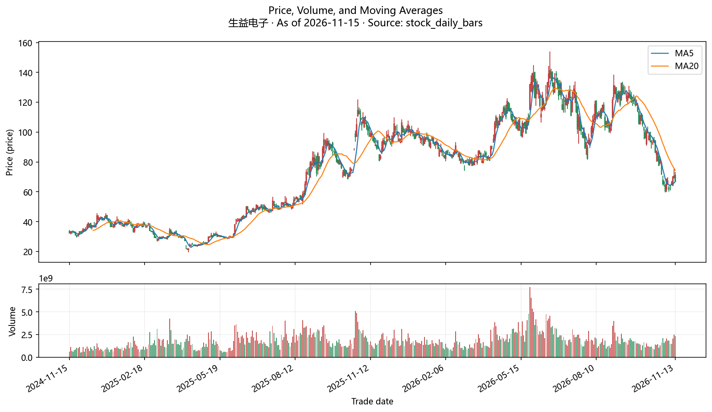
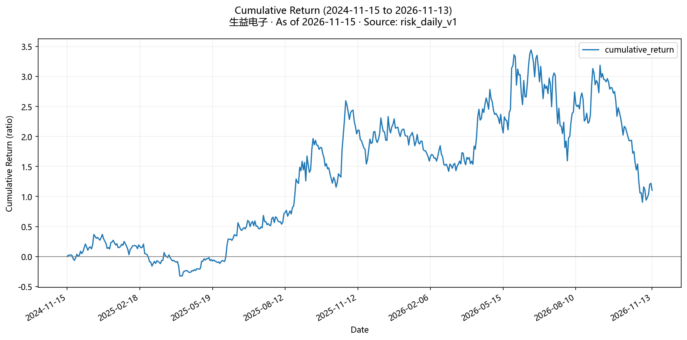
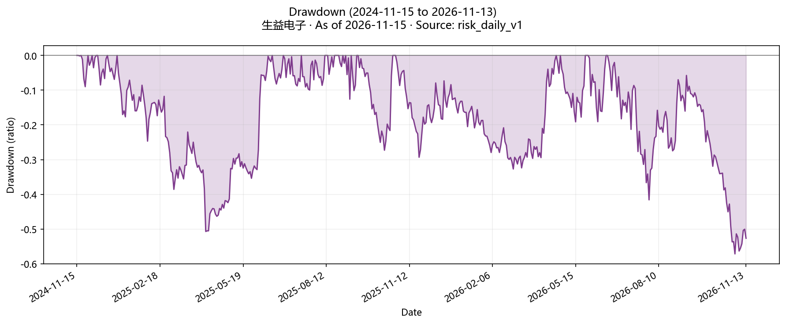
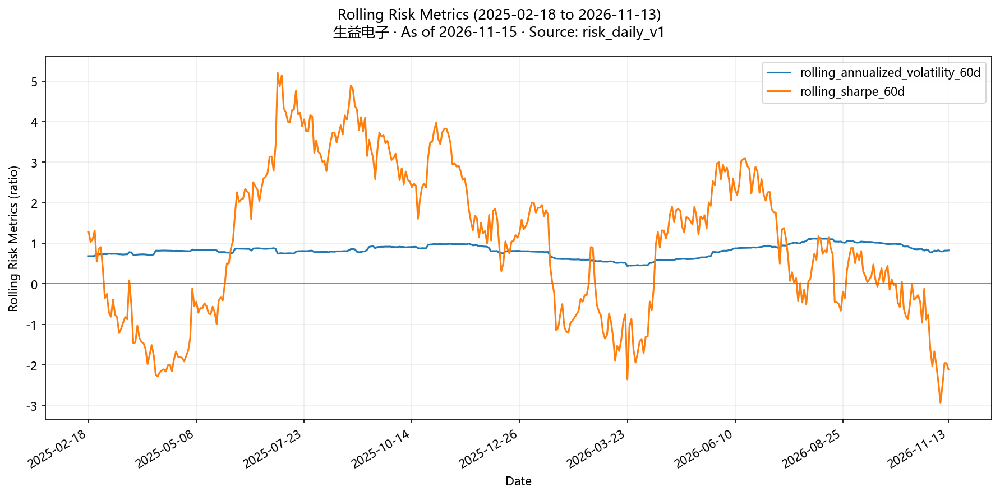

# 生益电子 基础研究包

- 截止日：2026-11-15

## 自动收集后的初步判断
- 自动收集已完成：行情、数据质量检查、因子与风险指标、基本面指标、相对基准、公告与研报证据、静态图表、研究规则。
- 中长期质量与估值规则结论为“未通过”；这是研究规则结果，不是投资指令。

## 行情与覆盖
- 最新收盘价：66.79元（来源记录，截至2026-11-13）
  - 限制：未复权价格。
- 行情覆盖：484个交易日，2024-11-15至2026-11-13（来源记录，截至2026-11-13）

## 收益与风险指标
- 本节口径：按执行窗口内的复权总回报计算（交易所前收盘价链接，含分红再投资，已消除送转、拆分和份额折算的影响）。
- 区间年化收益率：47.39%（派生指标，截至2026-11-13）
- 区间年化波动率：82.9%（派生指标，截至2026-11-13）
- 区间最大回撤：-57.15%（派生指标，截至2026-11-13）
- 区间夏普比率：0.874（派生指标，截至2026-11-13）
- 区间索提诺比率：1.449（派生指标，截至2026-11-13）
- 区间卡玛比率：0.829（派生指标，截至2026-11-13）
- 最长回撤持续时间：149天（派生指标，截至2026-11-13）

## 相对基准表现
- 本节口径：标的按复权总回报计算，基准为价格指数、不含分红，超额收益偏高约一个区间股息率；实际区间为2024-11-15至2026-11-13。
- 比较基准：沪深300指数（来源记录，截至2026-11-13）
- 区间累计收益率（标的）：110.32%（派生指标，截至2026-11-13）
- 区间累计收益率（基准）：1.2%（派生指标，截至2026-11-13）
- 相对基准超额收益：109.13%（派生指标，截至2026-11-13）
- 年化主动风险（跟踪误差）：75%（派生指标，截至2026-11-13）
- 信息比率：0.939（派生指标，截至2026-11-13）
- Beta：2.718（派生指标，截至2026-11-13）
- 与基准相关系数：0.55（派生指标，截至2026-11-13）
- 共同交易日数：483个（派生指标，截至2026-11-13）

## 相对行业表现
- 本节口径：申万行业指数为价格指数，不含分红；实际区间为2024-11-15至2026-11-13。行业按申万当前成分归属。
- 行业基准：申万电子（来源记录，截至2026-11-13）
- 区间累计收益率（行业指数）：49.65%（派生指标，截至2026-11-13）
- 相对行业超额收益：70.85%（派生指标，截至2026-11-13）
- 与行业指数相关系数：0.65（派生指标，截至2026-11-13）

## 估值
- 本节口径：基于2026-09-30报告期财报与截至2026-11-13的最新收盘价，流量项为滚动十二个月（TTM）口径。
- 本节口径：历史与同行分位见“估值位置”一节。
- 总市值：574.57亿元（派生指标，截至2026-11-15）
- 企业价值：578.17亿元（派生指标，截至2026-11-15）
- 市盈率（TTM）：25.31倍（派生指标，截至2026-11-15）
- 扣非市盈率（TTM）：25.38倍（派生指标，截至2026-11-15）
- 市净率：5.84倍（派生指标，截至2026-11-15）
- 市销率（TTM）：4.7倍（派生指标，截至2026-11-15）
- 市现率（TTM）：26.41倍（派生指标，截至2026-11-15）
- 盈利收益率：3.95%（派生指标，截至2026-11-15）
- 自由现金流收益率：-0.66%（派生指标，截至2026-11-15）
- 股息率：0.9%（派生指标，截至2026-11-15）

## 盈利能力
- 本节口径：基于2026-09-30报告期财报，流量项为滚动十二个月（TTM）口径。
- 本节口径：仅当前一期，未形成多期趋势。
- ROE：30.27%（派生指标，截至2026-11-15）
- 扣非 ROE：30.19%（派生指标，截至2026-11-15）
- 非经常性损益占归母净利润：0.29%（派生指标，截至2026-11-15）
- ROA：15.3%（派生指标，截至2026-11-15）
- ROIC：26.58%（派生指标，截至2026-11-15）
- 毛利率：33.89%（派生指标，截至2026-11-15）
- 营业利润率：20.69%（派生指标，截至2026-11-15）
- 净利率：18.59%（派生指标，截至2026-11-15）

## 成长
- 营业收入同比增速：46.5%（派生指标，截至2026-11-15）
  - 限制：2026-09-30报告期相对上年同期计算，流量项为滚动十二个月（TTM）口径。
- 净利润同比增速：80.15%（派生指标，截至2026-11-15）
  - 限制：2026-09-30报告期相对上年同期计算，流量项为滚动十二个月（TTM）口径。
- 扣非净利润同比增速：79.45%（派生指标，截至2026-11-15）
  - 限制：2026-09-30报告期相对上年同期计算，流量项为滚动十二个月（TTM）口径。
- 经营现金流同比增速：162.88%（派生指标，截至2026-11-15）
  - 限制：2026-09-30报告期相对上年同期计算，流量项为滚动十二个月（TTM）口径。
- 年初至2026-09-30累计同比（不滚动）：营业收入 +39.81%；归母净利润 +71.49%；扣非归母净利润 +71.59%（派生指标，截至2026-11-15）
  - 限制：TTM 增速反映过去四个季度，拐点会滞后；两者方向不同时，本行更接近最新趋势。

## 资产负债
- 本节口径：基于2026-09-30报告期末资产负债表。
- 资产负债率：46.68%（派生指标，截至2026-11-15）
- 净负债：3.6亿元（派生指标，截至2026-11-15）

## 研发投入
- 研发费用率：5.08%（派生指标，截至2026-11-15）
  - 限制：基于2026-09-30报告期，流量项为滚动十二个月（TTM）口径。
  - 限制：研发费用率 = 费用化研发支出 ÷ 营业收入，不含资本化部分。

## 分红
- 近 12 个月分红：近 12 个月每股现金分红 0.600 元（除息日 2026-06-05 每股 0.600 元），按现价 66.79 元股息率 0.90%（派生指标，截至2026-11-15）
  - 限制：新浪财经分红记录（已实施方案，派息按除息日归属）
  - 限制：只算已实施的现金分红（含税），已公告未除息的方案不计入；未按送转股调整。
- 按除息年度的每股分红：2021 年 0.330 元；2022 年 0.160 元；2023 年 0.160 元；2025 年 0.550 元；2026 年 0.600 元（派生指标，截至2026-11-15）
  - 限制：按除息日所在年度归属，不等于按会计年度的分配方案。

## 估值位置
- 本节口径：自身历史为月末样本加最新一天（东方财富，2018 年起）；同行为申万当前成分，取截止日或之前最近一天的估值；PE 只在盈利样本中排位。
- 市盈率(TTM)自身历史分位：6%（当前25.31倍；2021-02-26至2026-11-13 共68个样本，中位数48.14倍）（派生指标，截至2026-11-13）
- 市盈率(TTM)同行分位：12%（申万印制电路板 41家有效样本，同行中位数40.43倍）（派生指标，截至2026-11-15）
- 市净率自身历史分位：70%（当前5.84倍；2021-02-26至2026-11-13 共70个样本，中位数3.04倍）（派生指标，截至2026-11-13）
- 市净率同行分位：62%（申万印制电路板 45家有效样本，同行中位数4.70倍）（派生指标，截至2026-11-15）
- 市销率自身历史分位：64%（当前4.70倍；2021-02-26至2026-11-13 共70个样本，中位数3.30倍）（派生指标，截至2026-11-13）
- 市销率同行分位：67%（申万印制电路板 45家有效样本，同行中位数3.95倍）（派生指标，截至2026-11-15）

## 隐含预期与内在价值
- 本节口径：情景区间与敏感性只说明假设变化时价值的范围，不是目标价；反向 DCF 说明价格隐含的预期，不说明市场错了
- 隐含增速：自由现金流（TTM，经营现金流 − 购建长期资产）：基数不为正，不求解（派生指标，截至2026-11-15）
- 隐含增速：扣非归母净利润（TTM）：市值 575 亿元隐含未来 10 年年增 3.7%，之后永续 2%（派生指标，截至2026-11-15）
- 隐含高增长年限：按历史增速 75.1%，需持续 1 年才能支撑当前价格（派生指标，截至2026-11-15）
- 情景区间：悲观（年增 15.0%）每股 164.95 元，较现价 +147%；基准（年增 20.0%）每股 243.31 元，较现价 +264%；乐观（年增 25.0%）每股 355.59 元，较现价 +432%。基准增速取近 3 年扣非利润复合增速（不可算时依次用归母、营收），限制在 -5%–20%，悲观与乐观各 ±5%；情景以扣非归母净利润（TTM）为基数（派生指标，截至2026-11-15）
- 隐含回报：若基准增速 20.0% 兑现，按现价买入的年化回报约 14.8%（对照折现率 6.61%、10 年国债 1.61%）（派生指标，截至2026-11-15）
- 敏感性：折现率 5.61%–7.61%、永续增长 1%–3% 下，基准情景每股 169.77–428.84 元（派生指标，截至2026-11-15）
- 历史增速：2022–2025 年报 3 年复合增速：扣非 75.1%、归母 67.6%、营收 39.0%；2017–2025 营收复合增速 23.9%（派生指标，截至2026-11-15）
- 假设：折现率 6.61% = 10 年国债 1.61%（2026-11-13） + 股权风险溢价 5%；永续增长 2%；显式期 10 年（派生指标，截至2026-11-15）

## 研究规则检查
- 规则结论：未通过（中长期质量与估值规则；得分1，通过线0.65）（派生指标，截至2026-11-15）
  - 限制：阈值是初始研究假设
  - 限制：未经回测，也未按同行标准化
  - 限制：置信度只反映必需输入是否齐全，不代表结论正确的概率
  - 限制：规则结果有效期至2027-02-13。
- 硬性门槛：ROIC ≥ 10%（当前26.58%，满足）；自由现金流收益率 > 0%（当前-0.66%，未满足）（派生指标，截至2026-11-15）
  - 限制：阈值为研究假设，未经回测或同行标准化。
- 否决条件：资产负债率 > 70%（当前46.68%，未触发）（派生指标，截至2026-11-15）
  - 限制：阈值为研究假设，未经回测或同行标准化。
- 评分条件：ROE ≥ 15%（当前30.27%，满足，权重25%）；ROIC ≥ 15%（当前26.58%，满足，权重25%）；营业收入同比增速 > 0%（当前46.5%，满足，权重20%）；市盈率（TTM） ≤ 30倍（当前25.31倍，满足，权重30%）（派生指标，截至2026-11-15）
  - 限制：阈值为研究假设，未经回测或同行标准化。

## 公告与研报
- 证据覆盖：官方公告30条，第三方研报7条，结构化事件8个（2025-05-16至2026-11-15）（来源记录，截至2026-11-15）
- 公告：生益电子关于持股5%以上股东增持公司股份暨后续增持计划的公告（官方披露，截至2026-11-10）
- 公告：生益电子股份有限公司2026年第一次临时股东会会议资料（官方披露，截至2026-11-04）
- 公告：生益电子关于股份回购进展公告（官方披露，截至2026-11-03）
- 公告：中信证券股份有限公司、东莞证券股份有限公司关于生益电子股份有限公司补充确认使用部分暂时闲置募集资金进行现金管理暨增加现金管理额度之核查意见（官方披露，截至2026-10-30）
- 公告：中信证券股份有限公司、东莞证券股份有限公司关于生益电子股份有限公司增加2026年度日常关联交易预计之核查意见（官方披露，截至2026-10-30）
- 研报：生益电子：受益于AI算力领域高景气，产品优势持续巩固（华安证券，买入）（来源记录，截至2026-11-08）
  - 限制：第三方观点，不代表官方披露。
- 研报：Q3业绩大幅预增，AI算力产能释放驱动高增长（华金证券，增持）（来源记录，截至2026-10-19）
  - 限制：第三方观点，不代表官方披露。
- 研报：创一流企业，造百年生益（中邮证券，买入）（来源记录，截至2026-09-09）
  - 限制：第三方观点，不代表官方披露。

## 静态图表

## 初始三情景

### 乐观情景
- 已满足的条件（营业收入同比增速 > 0%；市盈率（TTM） ≤ 30倍；ROE ≥ 15%等）在下次刷新后继续成立。

### 基准情景
- 当前中长期质量与估值规则结论：未通过。

### 悲观情景
- 未满足或已触发的条件（自由现金流收益率 > 0%）继续恶化，或已满足的条件在刷新后失效。

## 最强反方
- 未满足的规则条件：自由现金流收益率 > 0%。

## 失效条件
- 刷新数据后，硬性门槛或否决条件的判定发生变化（核心前提失效）

## 缺口
- 暂无执行缺口；能力边界见各节口径与限制。
