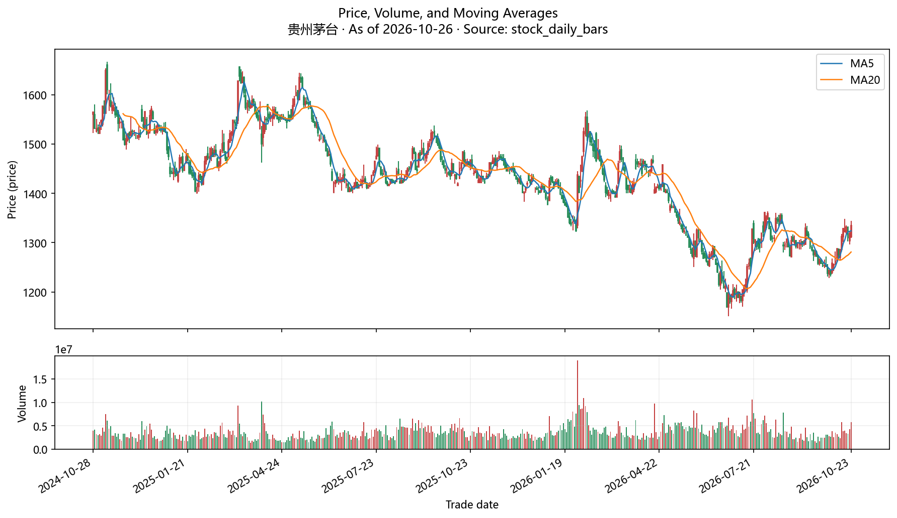
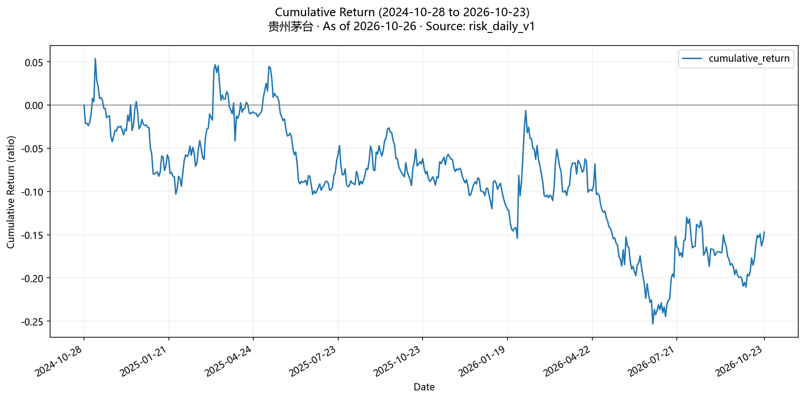
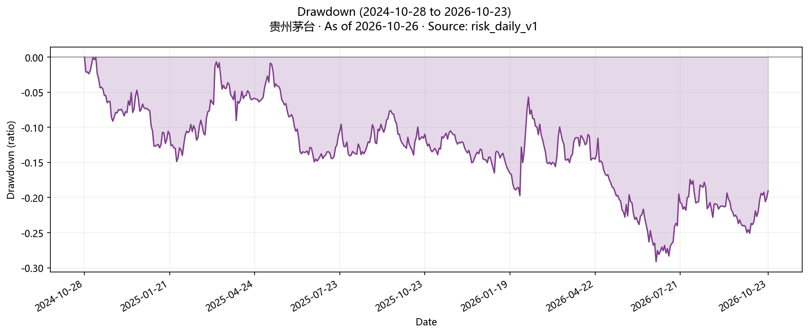
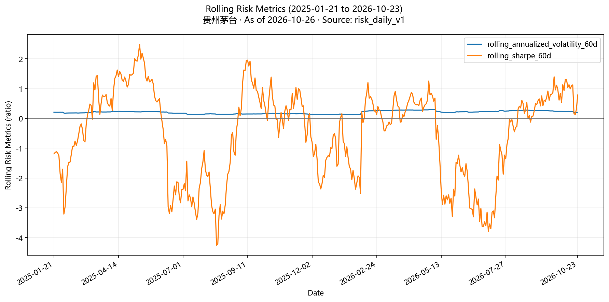

# 贵州茅台 基础研究包

- 截止日：2026-10-26

## 自动收集后的初步判断
- 自动收集已完成：行情、数据质量检查、因子与风险指标、基本面指标、相对基准、公告与研报证据、静态图表、研究规则。
- 中长期质量与估值规则结论为“通过”；这是研究规则结果，不是投资指令。

## 行情与覆盖
- 最新收盘价：1,335元（来源记录，截至2026-10-23）
  - 限制：未复权价格。
- 行情覆盖：483个交易日，2024-10-28至2026-10-23（来源记录，截至2026-10-23）

## 收益与风险指标
- 本节口径：按执行窗口内的日频未复权收盘价计算，不含分红；窗口内发生送转或拆分时，收益与回撤会失真。
- 区间年化收益率：-7.97%（派生指标，截至2026-10-23）
- 区间年化波动率：20.86%（派生指标，截至2026-10-23）
- 区间最大回撤：-29.14%（派生指标，截至2026-10-23）
- 区间夏普比率：-0.295（派生指标，截至2026-10-23）
- 区间索提诺比率：-0.459（派生指标，截至2026-10-23）
- 区间卡玛比率：-0.274（派生指标，截至2026-10-23）
- 最长回撤持续时间：715天（派生指标，截至2026-10-23）

## 相对基准表现
- 本节口径：按标的与基准共同交易日的未复权收盘价计算，不含分红；实际区间为2024-10-28至2026-10-23。
- 比较基准：沪深300指数（来源记录，截至2026-10-23）
- 区间累计收益率（标的）：-14.7%（派生指标，截至2026-10-23）
- 区间累计收益率（基准）：3.56%（派生指标，截至2026-10-23）
- 相对基准超额收益：-18.26%（派生指标，截至2026-10-23）
- 年化主动风险（跟踪误差）：22.86%（派生指标，截至2026-10-23）
- 信息比率：-0.413（派生指标，截至2026-10-23）
- Beta：0.349（派生指标，截至2026-10-23）
- 与基准相关系数：0.284（派生指标，截至2026-10-23）
- 共同交易日数：482个（派生指标，截至2026-10-23）

## 估值
- 本节口径：基于2026-06-30报告期财报与2026-10-26收盘价，流量项为滚动十二个月（TTM）口径。
- 本节口径：仅当前一个时点，尚无历史估值分位；未与同行比较，需要时在探索阶段查询同行。
- 总市值：16,688.59亿元（派生指标，截至2026-10-26）
- 企业价值：16,153.97亿元（派生指标，截至2026-10-26）
- 市盈率（TTM）：20.49倍（派生指标，截至2026-10-26）
- 市净率：6.64倍（派生指标，截至2026-10-26）
- 市销率（TTM）：9.63倍（派生指标，截至2026-10-26）
- 市现率（TTM）：14.01倍（派生指标，截至2026-10-26）
- 盈利收益率：4.88%（派生指标，截至2026-10-26）
- 自由现金流收益率：6.99%（派生指标，截至2026-10-26）
- 股息率：4.05%（派生指标，截至2026-10-26）

## 盈利能力
- 本节口径：基于2026-06-30报告期财报，流量项为滚动十二个月（TTM）口径。
- 本节口径：仅当前一期，未形成多期趋势。
- ROE：33.25%（派生指标，截至2026-10-26）
- ROA：27.09%（派生指标，截至2026-10-26）
- ROIC：43.85%（派生指标，截至2026-10-26）
- 毛利率：90.42%（派生指标，截至2026-10-26）
- 营业利润率：65.49%（派生指标，截至2026-10-26）
- 净利率：47.01%（派生指标，截至2026-10-26）

## 成长
- 本节口径：2026-06-30报告期相对上年同期计算，流量项为滚动十二个月（TTM）口径。
- 营业收入同比增速：-2.87%（派生指标，截至2026-10-26）
- 净利润同比增速：-9.45%（派生指标，截至2026-10-26）
- 经营现金流同比增速：72.7%（派生指标，截至2026-10-26）
- 自由现金流同比增速：81.77%（派生指标，截至2026-10-26）

## 资产负债
- 本节口径：基于2026-06-30报告期末资产负债表。
- 资产负债率：15.19%（派生指标，截至2026-10-26）
- 净负债：-534.62亿元（派生指标，截至2026-10-26）
- 利息保障倍数：705.73倍（派生指标，截至2026-10-26）

## 研究规则检查
- 规则结论：通过（中长期质量与估值规则；得分0.8，通过线0.65）（派生指标，截至2026-10-26）
  - 限制：阈值是初始研究假设
  - 限制：未经回测，也未按同行标准化
  - 限制：置信度只反映必需输入是否齐全，不代表结论正确的概率
  - 限制：规则结果有效期至2027-01-24。
- 硬性门槛：ROIC ≥ 10%（当前43.85%，满足）；自由现金流收益率 > 0%（当前6.99%，满足）（派生指标，截至2026-10-26）
  - 限制：阈值为研究假设，未经回测或同行标准化。
- 否决条件：资产负债率 > 70%（当前15.19%，未触发）（派生指标，截至2026-10-26）
  - 限制：阈值为研究假设，未经回测或同行标准化。
- 评分条件：ROE ≥ 15%（当前33.25%，满足，权重25%）；ROIC ≥ 15%（当前43.85%，满足，权重25%）；营业收入同比增速 > 0%（当前-2.87%，未满足，权重20%）；市盈率（TTM） ≤ 30倍（当前20.49倍，满足，权重30%）（派生指标，截至2026-10-26）
  - 限制：阈值为研究假设，未经回测或同行标准化。

## 公告与研报
- 证据覆盖：官方公告30条，第三方研报96条，结构化事件9个（2025-04-26至2026-10-26）（来源记录，截至2026-10-26）
- 公告：贵州茅台2026年半年度报告（官方披露，截至2026-08-15）
- 公告：贵州茅台关于会计政策变更的公告（官方披露，截至2026-08-15）
- 公告：贵州茅台关于贵州茅台集团财务有限公司的风险评估报告（官方披露，截至2026-08-15）
- 公告：贵州茅台第五届董事会2026年度第三次会议决议公告（官方披露，截至2026-08-15）
- 公告：贵州茅台2026年半年度报告摘要（官方披露，截至2026-08-15）
- 研报：贵州茅台公司跟踪报告：以动销定投放，缓解市场压力，低速稳态发展（诚通证券，买入）（来源记录，截至2026-09-21）
  - 限制：第三方观点，不代表官方披露。
- 研报：2026年中报点评：茅台酒稳健，系列酒主动调整（西南证券，买入）（来源记录，截至2026-08-21）
  - 限制：第三方观点，不代表官方披露。
- 研报：市场化改革带来短期业绩阵痛，公司改革成效显著，基本面仍具韧性（中银证券，买入）（来源记录，截至2026-08-21）
  - 限制：第三方观点，不代表官方披露。

## 静态图表

## 初始三情景

### 乐观情景
- 已满足的条件（自由现金流收益率 > 0%；市盈率（TTM） ≤ 30倍；ROE ≥ 15%等）在下次刷新后继续成立。

### 基准情景
- 当前中长期质量与估值规则结论：通过。

### 悲观情景
- 未满足或已触发的条件（营业收入同比增速 > 0%）继续恶化，或已满足的条件在刷新后失效。

## 最强反方
- 未满足的规则条件：营业收入同比增速 > 0%。

## 失效条件
- 刷新数据后，硬性门槛或否决条件的判定发生变化（核心前提失效）

## 缺口
- 暂无执行缺口；能力边界见各节口径与限制。
